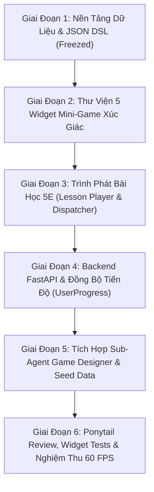

# Kế Hoạch Triển Khai Kỹ Thuật (Implementation Plan)
## Khung Bài Học Chuẩn 5E Đa Chủ Đề & Hệ Thống Mini-Game Xúc Giác
### Thematic 5E Lesson Template & Tactile Game Design Engine Plan

- **Mã tài liệu**: `PLAN-20261102-LESSON-GAMEDESIGN`
- **Phiên bản**: `1.0.0`
- **Ngày lập**: 2026-11-02
- **Căn cứ đặc tả**: [`SPEC-20261102-LESSON-GAMEDESIGN`](file:///c:/Projects/kiddora/docs/04-specifications/specs/2026-11-02-thematic-5e-lesson-template-and-game-design-spec.md)
- **Mục tiêu phiên bản**: `v0.6.0-lesson-player` (Sprint 6 — EPIC-08)
- **Sub-Agents phối hợp**: Project Manager, Tech Lead, Game Designer, Flutter Core Dev, Backend Dev, QA Tester
- **Quy chuẩn thực thi**: 8-Gate Feature Delivery Lifecycle & Kỷ luật Ponytail Clean Code

---

## 🗺️ 1. Lộ Trình Phân Kỳ 6 Giai Đoạn (Phased Roadmap)

---

## 📦 2. Ma Trận Phân Rã Công Việc Chi Tiết (WBS & Tasks)

### Giai Đoạn 1: Nền Tảng Dữ Liệu & Kịch Bản JSON DSL (Gate 0 / Gate 4A)
> **Mục tiêu**: Xây dựng mô hình dữ liệu bất biến `@freezed` trên Dart và bộ kiểm định JSON Schema kịch bản bài học.

- [ ] **Task 1.1**: Tạo thực thể Freezed `LessonBlueprint`, `LessonStageConfig`, `GameResult` tại `lib/features/exploration/domain/models/`.
- [ ] **Task 1.2**: Xây dựng bộ parser `fromJson`/`toJson` linh hoạt xử lý 4 Archetypes (`exploration`, `arcade`, `sandbox`, `story_quest`).
- [ ] **Task 1.3**: Soạn thảo 2 file kịch bản mẫu:
  - `assets/lessons/lesson_anim_01_exploration.json` (Khoa học: Gấu Bắc Cực & Sinh thái).
  - `assets/lessons/lesson_math_01_arcade.json` (Toán tư duy: Cân bằng số học).
- [ ] **Task 1.4**: Viết Unit Test kiểm tra tính toàn vẹn của JSON parser, xác thực không xảy ra lỗi parse dữ liệu thiếu hoặc sai kiểu.

---

### Giai Đoạn 2: Thư Viện 5 Widget Mini-Game Xúc Giác (Gate 4A)
> **Mục tiêu**: Hiện thực hóa 5 widget trò chơi đất sét 3D tái sử dụng tại `lib/shared/ui_kit/games/`, tích hợp Spring Physics và Rung phản hồi Haptic.

- [ ] **Task 2.1**: **`ClayDragDropSorter`**
  - Kéo thả vật thể vào 2–3 giỏ đất sét.
  - Hiệu ứng nhún đàn hồi khi thả (`SpringSimulation`), nảy phồng khi giữ.
  - Haptic feedback nhẹ khi đúng (`lightImpact`), nảy ngược khi sai kèm âm thanh bloop.
- [ ] **Task 2.2**: **`ClayScaleBalancer`**
  - Cân bập bênh bập bênh theo trọng số hai vế.
  - Trạng thái cân bằng: Hào quang Joyful Amber và rung kép xúc giác (`mediumImpact`).
- [ ] **Task 2.3**: **`ClayBubblePopper`**
  - Bong bóng chuyển động sóng sin trôi nổi.
  - Chạm nổ thành chùm sao vàng kèm âm thanh "pop".
- [ ] **Task 2.4**: **`MagicStrokeTracer`**
  - `CustomPainter` bắt tọa độ ngón tay vẽ nét neon ma thuật theo đường dẫn định sẵn.
  - Hiệu ứng hạt bụi tiên bay lấp lánh (fairy dust).
- [ ] **Task 2.5**: **`ClayCardFlipper`**
  - Hiệu ứng lật 3D $180^\circ$ chân thực (`Transform` với ma trận $4\times4$).
  - Ghép đúng: hòa tan vào nhau thành ngôi sao thưởng.

---

### Giai Đoạn 3: Trình Phát Bài Học 5E & Bộ Điều Phối (Lesson Player Engine) (Gate 4A)
> **Mục tiêu**: Màn hình mẹ điều khiển hành trình 5E liền mạch, chống xao nhãng và tạo cảm giác chinh phục.

- [ ] **Task 3.1**: Xây dựng `LessonPlayerController` (`AsyncNotifier` Riverpod):
  - Quản lý trạng thái chặng hiện tại ($1 \rightarrow 5$).
  - Đếm thời gian, lưu kết quả thử-sai, kích hoạt Smart Hint sau $15\text{s}$ không thao tác.
- [ ] **Task 3.2**: Xây dựng `LessonPlayerScreen` và thanh tiến độ hạt đậu nảy xúc giác (`lesson_progress_dots.dart`).
- [ ] **Task 3.3**: Xây dựng `LessonStageDispatcher`:
  - Tự động chuyển đổi hiển thị:
    * Chặng 1 (`Engage`): Hội thoại Mascot đặt câu hỏi.
    * Chặng 2 (`Explore`): Khám phá tự do (Kính lúp / Chạm mở).
    * Chặng 3 (`Explain`): Video player ngắn gọn hoặc thẻ minh họa 3D.
    * Chặng 4 (`Elaborate`): Mini-game từ Giai đoạn 2.
    * Chặng 5 (`Evaluate`): Màn ăn mừng, thưởng $+10$ Sao và giữ chuỗi Streak.
- [ ] **Task 3.4**: Xây dựng hộp thoại thoát thân thiện (`ExitConfirmationDialog`) bảo toàn tiến độ đang dở.

---

### Giai Đoạn 4: Mở Rộng Backend FastAPI & Đồng Bộ Tiến Độ (Gate 4B)
> **Mục tiêu**: Cung cấp API lưu trữ kịch bản bài học và ghi nhận tiến độ học tập của trẻ.

- [ ] **Task 4.1**: Cập nhật SQLAlchemy model `Lesson` trong `backend/app/modules/courses/models.py`: bổ sung cột `blueprint_json` (PostgreSQL `JSONB`).
- [ ] **Task 4.2**: Viết migration Alembic cập nhật bảng `lessons`.
- [ ] **Task 4.3**: Thêm 2 endpoints RESTful:
  - `GET /api/v1/lessons/{id}/blueprint`: Lấy kịch bản bài học.
  - `POST /api/v1/lessons/{id}/complete`: Ghi nhận hoàn thành, cộng $+10\text{ Star Points}` vào `kid_profiles` và cập nhật `streak_days`.
- [ ] **Task 4.4**: Viết Pytest kiểm thử 100% các endpoint mới (happy path & ngoại lệ 404).

---

### Giai Đoạn 5: Tích Hợp Sub-Agent Game Designer & Bộ Kịch Bản (Gate 1 & 2)
> **Mục tiêu**: Chuẩn hóa năng lực sản xuất nội dung game tự động hóa.

- [ ] **Task 5.1**: Thiết lập Sub-Agent `game_designer` trong hệ sinh thái Sub-Agents của Kiddora với Persona chuyên môn hóa và System Prompt chuẩn mực.
- [ ] **Task 5.2**: Ban hành cẩm nang thiết kế kịch bản game (Game Design Guidelines) cho các bài học tiếp theo.
- [ ] **Task 5.3**: Đóng gói seed data 5 bài học hoàn chỉnh cho khóa học `Amazing Animals`.

---

### Giai Đoạn 6: Ponytail Review, Widget Tests & Nghiệm Thu 60 FPS (Gate 5 & 6)
> **Mục tiêu**: Đảm bảo mã nguồn tối giản, không bloat, 0 lỗi tràn viền và đạt chuẩn WCAG 2.2 AA.

- [ ] **Task 6.1**: **Ponytail Git Diff Review (Gate 5)**:
  - Triệt tiêu mọi Magic Number, $100\%$ sử dụng `AppColors`, `AppValues`, `AppStrings`.
  - Mọi file mã nguồn tuân thủ giới hạn $< 200$ dòng.
- [ ] **Task 6.2**: **Kiểm Thử Tự Động (Gate 6)**:
  - Widget tests mô phỏng thao tác kéo thả và chạm nút trên từng mini-game.
  - Golden tests / Preview test trên màn hình nhỏ $360\times640$ với `textScaler: 1.5x`.
- [ ] **Task 6.3**: **Kiểm Toán An Ninh & COPPA (Gate 6.5)**:
  - Không truyền bất kỳ thông tin nhận dạng cá nhân nào trong quá trình gửi telemetry tiến độ bài học.
  - Đảm bảo cơ chế lưu trữ cục bộ Offline an toàn.

---

## 🎯 3. Tiêu Chuẩn Hoàn Thành (Definition of Done)
1. Cả 5 widget mini-game chạy mượt mà 60 FPS trên cả thiết bị giả lập và thiết bị thật.
2. Trẻ hoàn thành trọn vẹn 1 bài học từ Chặng 1 đến Chặng 5 mà không bị crash hay tràn viền.
3. $100\%$ tests (Unit test, Widget test, Pytest BE) vượt qua thành công.
4. Tài liệu đặc tả và mã nguồn đồng bộ hoàn toàn (Zero Doc Drift).
