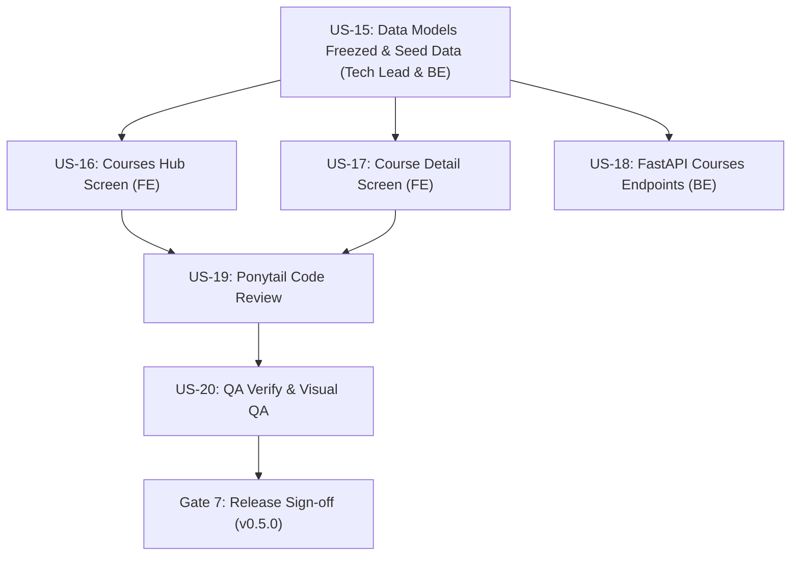

# Kế Hoạch Sprint 5 (Sprint 5 Planning)
## Phân Hệ Khám Phá Khóa Học & Chi Tiết Lộ Trình (Courses Discovery & Curriculum)

- **Scrum Master (SM)**: Sub-Agent Scrum Master — *"The Servant Leader & Agile Coach"*
- **Project Manager (PM)**: Sub-Agent Project Manager — *"The Clockwork Disciplinarian"*
- **Product Owner (PO)**: Sub-Agent Product Owner — *"The Strategic Tyrant"*
- **Tech Lead**: Sub-Agent Tech Lead & System Architect
- **Thời gian Sprint**: Tuần 7 & 8 (2 tuần)
- **Phiên bản đích**: `v0.5.0-courses-hub`
- **Trạng thái**: `PLANNING_AND_READY`

---

## 🧭 1. Bối Cảnh & Giả Định (Context & Assumptions)
- **Quy mô đội ngũ**: Đội hình đầy đủ 12 Sub-Agents tinh gọn (PO, PM, SM, Tech Lead, BA, UI/UX, Dev FE, Dev BE, Reviewer, QA, AppSec, DevOps).
- **Velocity tham chiếu**: 
  - Sprint 1: 22 SP
  - Sprint 2: 5 SP
  - Sprint 3: 13 SP
  - Sprint 4: 15 SP (+ 26 SP UI Kit mở rộng)
  - $\rightarrow$ Velocity trung bình bền vững (không tính CR đột xuất): **16–20 SP / Sprint**.
- **Mức cam kết Sprint 5**: **20 SP** (Vừa sức, tối ưu hóa năng lực chuyển đổi học tập).

---

## ⚡ 2. Sức Chứa Sprint (Capacity Breakdown)
- **Số ngày làm việc**: 10 ngày làm việc (2 tuần).
- **Hạn mức phân bổ thời gian**:
  - Phát triển tính năng chính (Must-have): **65%** (~13 SP)
  - Kiểm thử, Visual QA, Tối ưu hóa 60 FPS: **20%** (~4 SP)
  - Kaizen & Chuẩn bị Mock Seed Data (KZN-01): **15%** (~3 SP)
- **Quy tắc bảo vệ Sprint Goal (KZN-02)**: Áp dụng cơ chế **CR Buffer Gate** — Không nhận thêm CR ngoài scope giữa chừng; mọi yêu cầu mới ghi nhận vào Backlog Sprint 5.5.

---

## 🎯 3. Mục Tiêu Sprint (Sprint Goal)

> *"Hiện thực hóa Phân hệ Khám phá Khóa học (Courses Hub & Smart Discovery) và Chi tiết Khóa học (Course Detail & Curriculum), tích hợp bộ lọc môn học ClayFilterBar, thẻ bài học xúc giác 3D, đồng bộ Mock & REST API danh mục khóa học chuẩn Freezed."*

---

## 📋 4. Danh Sách Backlog Items Đưa Vào Sprint 5

| Mã US | Hạng Mục / User Story | MoSCoW | SP | Sub-Agent Phụ Trách | Tiêu Chuẩn Sẵn Sàng (DoR) & DoD |
| :---: | :--- | :---: | :---: | :---: | :--- |
| **US-15** | **[KZN-01] Khởi tạo Data Models Freezed & Seed Data** | Must-have | 3 | `tech-lead` / `backend-dev` | Entities `Course`, `Lesson`, `Subject` bằng `@freezed`, migration 0002 PostgreSQL, Mock Repository. |
| **US-16** | **Màn hình Khám Phá Khóa Học (Courses Hub & Discovery)** | Must-have | 5 | `flutter-core-dev` | Màn hình lưới 2 cột, `ClaySearchBar`, `ClayFilterBar` 4 môn (Toán, STEM, Nghệ thuật, Ngôn ngữ), `StarCounterBadge`. |
| **US-17** | **Màn hình Chi Tiết Khóa Học (Course Detail & Curriculum)** | Must-have | 5 | `flutter-core-dev` | Hero 3D Card, 3 Tabs (`Lessons`, `About`, `Reviews`), Danh sách bài học xúc giác, Nút Bắt đầu học `ClayButton`. |
| **US-18** | **FastAPI REST Endpoints cho Courses Catalog & Pytest** | Should-have | 3 | `backend-dev` | `GET /api/v1/courses`, `GET /api/v1/courses/{id}`, lọc theo môn học và độ tuổi; Pytest suite 100% pass. |
| **US-19** | **Ponytail Git Diff Review & Tối Giản Hóa Mã Nguồn** | Must-have | 1 | `code-reviewer` | 0 Magic numbers, 0 Emojis trong code, 100% `AppStrings`, files < 200 dòng, tái sử dụng UI Kit v2. |
| **US-20** | **QA Test Suite E2E & Visual QA Test Matrix** | Must-have | 3 | `qa-tester` | Chống tràn trên $360\times640$ với `textScaler: 1.5x`, kiểm định 60 FPS mượt mà. |

---

## 🛡️ 5. Ma Trận Rủi Ro & Phụ Thuộc (Dependencies & Risks)

- **Điểm phụ thuộc cốt lõi**: US-15 (Data Models Freezed) là đầu vào quyết định cho cả FE lẫn BE. Cần hoàn thành ngay trong 2 ngày đầu Sprint.
- **Rủi ro hình ảnh khóa học**: Tránh tải ảnh quá nặng từ mạng gây giật khung hình; sử dụng cache ảnh `cached_network_image` kết hợp fallback placeholder xúc giác dạng 3D Clay.

---

## 🗓️ 6. Kế Hoạch Theo Dõi & Nhịp Độ Sự Kiện Scrum

1. **Daily Scrum**: 15 phút mỗi ngày lúc 09:00 sáng, tập trung vào 3 câu hỏi:
   - Đã đóng task WBS nào?
   - Hôm nay cam kết kéo task nào tiếp theo?
   - Có vướng mắc (Impediment) nào cần SM tháo gỡ ngay không?
2. **Mid-Sprint Checkpoint (Ngày 5)**: Rà soát tiến độ burndown: Nếu US-15 & US-16 hoàn thành đạt $\ge 50\%$ tiến độ, kích hoạt song song US-17 và US-18.
3. **Sprint Review & Demo (Ngày 10)**: Demo trực tiếp luồng khám phá khóa học từ Home $\rightarrow$ Lọc môn Toán/STEM $\rightarrow$ Xem chi tiết bài giảng $\rightarrow$ Bấm xem nội dung bài học.
4. **Sprint Retrospective (Ngày 10)**: Kiểm tra hiệu quả của 2 Kaizen Actions (KZN-01 và KZN-02).

---

## 🏁 7. Tiêu Chuẩn Nghiệm Thu (Definition of Done - DoD)
- [ ] 100% User Stories đáp ứng tiêu chí BDD Given-When-Then.
- [ ] $0$ lỗi phân tích cú pháp (`flutter analyze` hoàn toàn sạch).
- [ ] 100% unit tests và widget tests pass thực tế.
- [ ] $0$ lỗi RenderFlex overflow trên màn hình $360\times640$ và `textScaler: 1.5x`.
- [ ] Tuân thủ tuyệt đối quy tắc Ponytail Clean Code (Zero magic numbers, 100% `AppStrings`, 100% `AppColors`).
- [ ] Tài liệu đồng bộ Zero-Drift: cập nhật PRD, Data Dictionary, WBS và chạy `graphify update .`.
