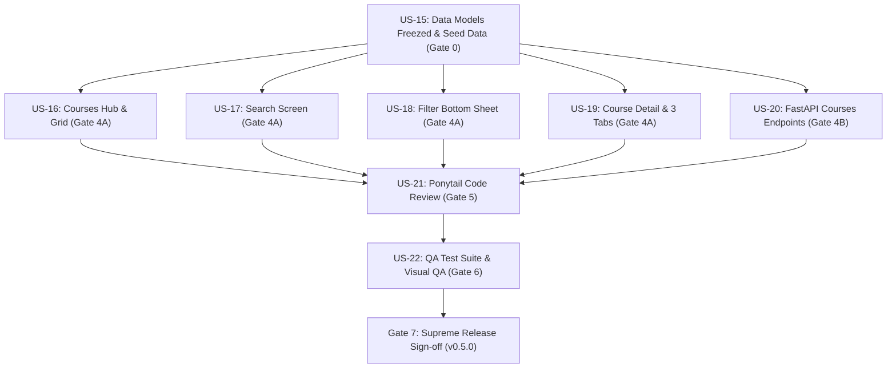

# Kế Hoạch Sprint 5 (Sprint 5 Planning) — Phương Án A (Approved)
## Phân Hệ Khám Phá Khóa Học & Chi Tiết Giáo Trình (Courses Discovery & Curriculum)
### Tái Hiện 1:1 Bộ 6 Màn Hình Dribbble Benchmark (Domain 04 & Domain 05)

- **Scrum Master (SM)**: Sub-Agent Scrum Master — *"The Servant Leader & Agile Coach"*
- **Project Manager (PM)**: Sub-Agent Project Manager — *"The Clockwork Disciplinarian"*
- **Product Owner (PO)**: Sub-Agent Product Owner — *"The Strategic Tyrant"*
- **Tech Lead**: Sub-Agent Tech Lead & System Architect
- **Thời gian Sprint**: Tuần 7 & 8 (2 tuần)
- **Phiên bản đích**: `v0.5.0-courses-hub`
- **Tổng Story Points cam kết**: **22 SP**
- **Trạng thái**: `PLANNING_AND_READY` (Đã phê duyệt Phương án A)

---

## 🧭 1. Bối Cảnh & Giả Định (Context & Scope Decision)

- **Quyết định phạm vi (PO Decision - Phương án A)**: 
  - Tập trung chuyên sâu vào **6 màn hình cốt lõi của Domain 04 & Domain 05** để mang lại trải nghiệm Khám phá, Tìm kiếm, Lọc đa tiêu chí và Chi tiết giáo trình đạt độ hoàn thiện 1:1 cao nhất.
  - Cụm Domain 06 (*Self-Paced Learning & Lesson Player* gồm 3 màn hình `06_learning_01` $\rightarrow$ `06_learning_03`) được lên lịch cho Sprint tiếp theo (Sprint 6) để bảo vệ năng lực thực thi và tránh quá tải.
- **Velocity tham chiếu**: $16–20$ SP trung bình $\rightarrow$ Cam kết **22 SP** vừa vặn và khả thi cho toàn đội ngũ 12 Sub-Agents.

---

## 📱 2. Danh Mục 6 Màn Hình Benchmark Đối Sánh 1:1

Toàn bộ quá trình phát triển (FE, BE, Review, QA) bắt buộc phải đối chiếu trực tiếp với các tài sản thiết kế tại `assets/design_references/screens/`:

| STT | Mã File Benchmark | Tên Màn Hình & Tiêu Đề | Thành Phần Trực Quan Bắt Buộc | User Story |
| :---: | :--- | :--- | :--- | :---: |
| 1 | [`04_courses_01_explore_and_categories.png`](file:///Users/nguyenduytrang/flutter_project/kiddora/assets/design_references/screens/04_courses_01_explore_and_categories.png) | Courses Hub (*"Explore, Learn and Grow!"*) | Header lời chào, `ClaySearchBar`, `ClayFilterBar` 5 chip môn học (*All, Science, Math, Language, Arts*), Lưới thẻ Popular Courses (Amazing Animals, Math Fun, Space Exploration, Creative Drawing). | **US-16** |
| 2 | [`04_courses_02_search_courses.png`](file:///Users/nguyenduytrang/flutter_project/kiddora/assets/design_references/screens/04_courses_02_search_courses.png) | Search Results Screen (*"Search Results (12)"*) | Ô tìm kiếm có từ khóa `"Space"`, Danh sách kết quả dạng thẻ nổi xúc giác với thông tin số bài học, độ tuổi và nút mũi tên chi tiết. | **US-17** |
| 3 | [`04_courses_03_filter_courses_sheet.png`](file:///Users/nguyenduytrang/flutter_project/kiddora/assets/design_references/screens/04_courses_03_filter_courses_sheet.png) | Filter Courses Bottom Sheet | Bộ lọc đa tiêu chí bằng chip đất sét: Ngành học (Program/Category), Độ tuổi (6–8, 9–10, 11–12), Cấp độ (Beginner, Intermediate, Advanced), Nút `[Clear All]` và `[Apply Filters]`. | **US-18** |
| 4 | [`04_courses_04_all_courses_grid.png`](file:///Users/nguyenduytrang/flutter_project/kiddora/assets/design_references/screens/04_courses_04_all_courses_grid.png) | All Courses Grid View | Lưới 2 cột hiển thị toàn bộ khóa học kèm hình minh họa 3D, phân loại môn học, số bài giảng và nhãn lứa tuổi (Ages 7–10, 8–12). | **US-16** |
| 5 | [`05_course_detail_01_overview_about.png`](file:///Users/nguyenduytrang/flutter_project/kiddora/assets/design_references/screens/05_course_detail_01_overview_about.png) | Course Overview (*"Amazing Animals"*) | Banner khóa học, Đánh giá 4.8 sao (320 reviews), Đoạn mô tả sinh động, 4 icon tính năng nổi (*Fun Videos, Interactive Quizzes, Activity Sheets, Earn Badges*), Nút CTA lớn `[Start Learning]`. | **US-19** |
| 6 | [`05_course_detail_02_curriculum_lessons.png`](file:///Users/nguyenduytrang/flutter_project/kiddora/assets/design_references/screens/05_course_detail_02_curriculum_lessons.png) | Lessons Curriculum List | Bộ 3 tab (*Lessons, About, Reviews*), Danh sách từng bài học kèm thời lượng (*Meet the Animals 10 min, Animals & Habitats 15 min*), Thẻ nhắc nhở huy hiệu đặc biệt. | **US-19** |

---

## 🎯 3. Mục Tiêu Sprint (Sprint Goal)

> *"Hiện thực hóa trọn gói 6 màn hình chuẩn 1:1 Design References Dribbble cho Phân hệ Khám phá Khóa học (Courses Hub, Search, Multi-criteria Filter) và Chi tiết Khóa học (Hero 3D, 3 Tabs, Giáo trình bài học), kết nối đồng bộ Mock Data Freezed và REST API FastAPI."*

---

## 📋 4. Danh Sách User Stories & Phân Rã Công Việc (22 SP)

| Mã US | Hạng Mục / User Story | MoSCoW | SP | Sub-Agent Phụ Trách | Màn Hình Benchmark Đối Sánh | Tiêu Chuẩn Hoàn Thành (DoD) |
| :---: | :--- | :---: | :---: | :---: | :--- | :--- |
| **US-15** | **[KZN-01] Data Models Freezed & Seed Data** | Must-have | 3 | `tech-lead` / `backend-dev` | Hệ thống thực thể | Entities `Course`, `Lesson`, `Subject`, `CourseFilter` bằng `@freezed`; Seed data 12 khóa học mẫu; Mock Repository. |
| **US-16** | **Courses Hub & Grid View** | Must-have | 4 | `flutter-core-dev` | `04_courses_01`, `04_courses_04` | `CoursesHubScreen`, lưới 2 cột, header *"Explore, Learn and Grow!"*, thanh tìm kiếm, dải chip môn học, tái sử dụng UI Kit v2. |
| **US-17** | **Real-time Course Search Screen** | Must-have | 3 | `flutter-core-dev` | `04_courses_02` | `CourseSearchScreen`, tìm kiếm tức thời theo từ khóa, danh sách kết quả thẻ nổi xúc giác, hiển thị số bài học và lứa tuổi. |
| **US-18** | **Multi-Criteria Filter Bottom Sheet** | Must-have | 3 | `flutter-core-dev` | `04_courses_03` | `CourseFilterSheet`, bộ lọc đất sét theo Môn, Tuổi (6–8, 9–10, 11–12), Cấp độ (Beginner/Intermediate/Advanced), nút Clear All & Apply. |
| **US-19** | **Course Detail Screen & 3 Tabs Curriculum** | Must-have | 4 | `flutter-core-dev` | `05_course_detail_01`, `05_course_detail_02` | `CourseDetailScreen`, Hero 3D Card, Rating sao, 4 icon tính năng, 3 tabs (Lessons, About, Reviews), danh sách bài học có duration, nút CTA. |
| **US-20** | **FastAPI REST Endpoints cho Courses & Pytest** | Should-have | 3 | `backend-dev` | Toàn bộ API Backend | `GET /courses`, `GET /courses/{id}`, `/subjects`, query filters (category, age, level), Pytest suite pass 100%. |
| **US-21** | **Ponytail Git Diff Review (Zero Bloat)** | Must-have | 1 | `code-reviewer` | Toàn bộ mã nguồn | 0 Magic numbers, 0 Emojis trong code, 100% `AppStrings`, files < 200 dòng, tái sử dụng UI Kit v2. |
| **US-22** | **QA Automated Test Suite & Visual QA Matrix** | Must-have | 1 | `qa-tester` | Cả 6 màn hình | Widget tests cho cả 6 màn hình, test matrix chống tràn $360\times640$ với `textScaler: 1.5x`, 60 FPS mượt mà. |

---

## 🛡️ 5. Ma Trận Phụ Thuộc & Kế Hoạch Triển Khai (Execution Flow)

---

## 🏁 6. Tiêu Chuẩn Nghiệm Thu Áp Dụng (Definition of Done - DoD)
- [ ] Tái hiện chính xác $100\%$ tỷ lệ, màu sắc, bóng đổ đất sét Tactile Claymorphism của cả 6 màn hình benchmark.
- [ ] Toàn bộ $83$ tests cũ tiếp tục pass + bổ sung đầy đủ widget tests mới cho 6 màn hình.
- [ ] $0$ lỗi `RenderFlex overflowed` trên màn hình nhỏ $360\times640$ khi bật cỡ chữ lớn `textScaler: 1.5x`.
- [ ] Tuân thủ triệt để Ponytail Clean Code: $100\%$ chuỗi văn bản khai báo tại `AppStrings`, $100\%$ màu tại `AppColors`, $0$ Magic Numbers.
- [ ] Áp dụng quy tắc **CR Buffer Gate (KZN-02)**: Không nhận CR phát sinh ngoài scope giữa chừng; mọi đề xuất mới chuyển vào Sprint 5.5.
