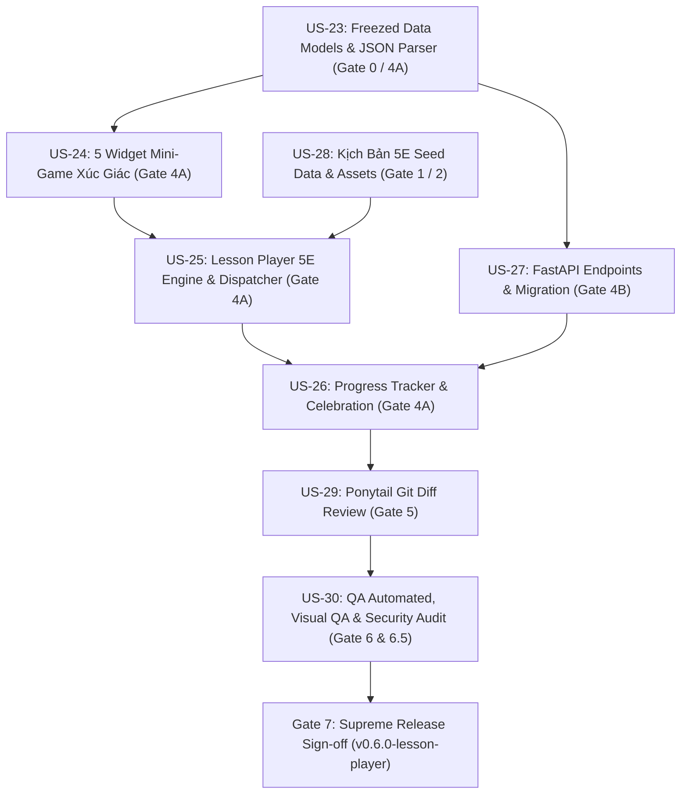

# Kế Hoạch Sprint 6 (Sprint 6 Planning) — Approved
## Trình Phát Bài Học Chuẩn Sư Phạm 5E & Hệ Thống Mini-Game Xúc Giác
### Tái Hiện 1:1 Bộ 3 Màn Hình Benchmark Domain 06 (`06_learning_01` $\rightarrow$ `06_learning_03`) & Thư Viện Mini-Game Đất Nặn

- **Scrum Master (SM)**: Sub-Agent Scrum Master — *"The Servant Leader & Agile Coach"*
- **Project Manager (PM)**: Sub-Agent Project Manager — *"The Clockwork Disciplinarian"*
- **Product Owner (PO)**: Sub-Agent Product Owner — *"The Strategic Tyrant"*
- **Tech Lead**: Sub-Agent Tech Lead & System Architect — *"The Pragmatic System Architect"*
- **Thời gian Sprint**: Tuần 9 & 10 (2 tuần)
- **Phiên bản đích**: `v0.6.0-lesson-player`
- **Tổng Story Points cam kết**: **25 SP**
- **Trạng thái**: `PLANNING_AND_READY` (Đã phê duyệt Phạm vi & Kế hoạch Kỹ thuật)

---

## 🧭 1. Bối Cảnh & Quyết Định Phạm Vi (Context & Scope Alignment)

- **Căn cứ kế hoạch & đặc tả**:
  - [`SPEC-20261102-LESSON-GAMEDESIGN`](file:///Users/nguyenduytrang/flutter_project/kiddora/docs/04-specifications/specs/2026-11-02-thematic-5e-lesson-template-and-game-design-spec.md)
  - [`PLAN-20261102-LESSON-GAMEDESIGN`](file:///Users/nguyenduytrang/flutter_project/kiddora/docs/00-project-management/plans/2026-11-02-thematic-5e-lesson-template-and-game-design-plan.md)
  - [EPIC-08: Self-Paced Learning & Lesson Player](file:///Users/nguyenduytrang/flutter_project/kiddora/docs/00-roadmap/epics-backlog.md)
- **Quyết định của Product Owner (PO)**:
  - Sprint 6 là cột mốc chuyển mình cốt lõi của Kiddora: từ **Khám phá Khóa học (Courses Discovery)** sang **Học tập Thực chiến (Interactive Learning)**.
  - Tích hợp chu trình sư phạm quốc tế **5E** (*Engage – Explore – Explain – Elaborate – Evaluate*) với định dạng bài học chia nhỏ vi mô (**Bite-sized: 7–12 phút**).
  - Triệt tiêu hoàn toàn bài kiểm tra trắc nghiệm chữ A/B/C/D nhàm chán bằng **5 Widget Mini-Game Xúc Giác Đất Nặn** (`ClayDragDropSorter`, `ClayScaleBalancer`, `ClayBubblePopper`, `MagicStrokeTracer`, `ClayCardFlipper`).
- **Velocity tham chiếu**: $23$ SP bàn giao tại Sprint 5 $\rightarrow$ Cam kết **25 SP** hoàn toàn khả thi và cân đối giữa FE Flutter (17 SP), BE FastAPI (3 SP), QA & Review (4 SP), BA & Assets (1 SP).

---

## 📱 2. Danh Mục 3 Màn Hình Benchmark Domain 06 Đối Sánh 1:1

Toàn bộ quá trình phát triển bắt buộc đối chiếu trực tiếp với các tài sản thiết kế tại `assets/design_references/screens/`:

| STT | Mã File Benchmark | Tên Màn Hình & Tiêu Đề | Thành Phần Trực Quan Bắt Buộc | User Story |
| :---: | :--- | :--- | :--- | :---: |
| 1 | [`06_learning_01_continue_lesson_player.png`](file:///Users/nguyenduytrang/flutter_project/kiddora/assets/design_references/screens/06_learning_01_continue_lesson_player.png) | Continue Lesson Player Screen | Header thanh tiến độ hạt đậu nảy xúc giác (Stage Dots E1$\rightarrow$E5), nút Thoát [X] kèm Dialog xác nhận, khung nội dung tương tác trung tâm 5E, Mascot thoại hướng dẫn, nút hành động đất sét đáy. | **US-25** |
| 2 | [`06_learning_02_course_progress_tracker.png`](file:///Users/nguyenduytrang/flutter_project/kiddora/assets/design_references/screens/06_learning_02_course_progress_tracker.png) | Course Progress Tracker Screen | Khung tiến độ tổng quan khóa học, danh sách module bài học phân đoạn với 3 trạng thái rõ rệt (Completed tick xanh, In Progress tím active, Locked xám ổ khóa), số sao tích lũy. | **US-26** |
| 3 | [`06_learning_03_course_completed_celebration.png`](file:///Users/nguyenduytrang/flutter_project/kiddora/assets/design_references/screens/06_learning_03_course_completed_celebration.png) | Course Completed Celebration Screen | Màn hình vinh danh ăn mừng: Pháo hoa ngôi sao đất sét, Linh vật nhảy múa, Huy hiệu hoàn thành khóa học 3D, Thưởng $+10$ Sao, Nút CTA [Tiếp tục chặng đường]. | **US-26** |

---

## 🎯 3. Mục Tiêu Sprint (Sprint Goal)

> *"Hiện thực hóa Trình phát bài học chuẩn Sư phạm 5E (Engage - Explore - Explain - Elaborate - Evaluate) tương thích 3 màn hình benchmark Domain 06 (Continue Lesson, Progress Tracker, Celebration), tích hợp bộ 5 Widget Mini-Game Xúc Giác Đất Nặn Play-Doh (ClayDragDropSorter, ClayScaleBalancer, ClayBubblePopper, MagicStrokeTracer, ClayCardFlipper), kịch bản JSON DSL Freezed và API Đồng bộ tiến độ (FastAPI UserProgress)."*

---

## 📋 4. Danh Sách User Stories & Phân Rã Fibonacci (25 SP)

| Mã US | Hạng Mục / User Story | MoSCoW | SP | Sub-Agent | Cổng | Tiêu Chuẩn Hoàn Thành (DoD) |
| :---: | :--- | :---: | :---: | :---: | :---: | :--- |
| **US-23** | **Data Models Freezed `LessonBlueprint` & JSON DSL Parser** | Must-have | 3 | `tech-lead` / `flutter-core-dev` | Gate 0 / 4A | Entities `LessonBlueprint`, `LessonStageConfig`, `GameResult` chuẩn `@freezed`; Parser `fromJson`/`toJson` linh hoạt 4 Archetypes; 2 kịch bản mẫu JSON. |
| **US-24** | **Thư Viện 5 Widget Mini-Game Xúc Giác Đất Nặn (`shared/ui_kit/games/`)** | Must-have | 5 | `flutter-core-dev` | Gate 4A | `ClayDragDropSorter`, `ClayScaleBalancer`, `ClayBubblePopper`, `MagicStrokeTracer`, `ClayCardFlipper`. Tích hợp Spring physics, Haptic feedback, 60 FPS, Safe-to-Fail. |
| **US-25** | **Trình Phát Bài Học 5E Engine & Bộ Điều Phối (`06_learning_01`)** | Must-have | 5 | `flutter-core-dev` | Gate 4A | `LessonPlayerScreen`, `LessonPlayerController` (`AsyncNotifier`), `LessonStageDispatcher` chuyển 5 chặng E1$\rightarrow$E5, hạt đậu tiến độ nảy `LessonProgressDots`, `ExitConfirmationDialog`. |
| **US-26** | **Màn Hình Tiến Độ & Ăn Mừng Hoàn Thành (`06_learning_02`, `06_learning_03`)** | Must-have | 4 | `flutter-core-dev` | Gate 4A | `CourseProgressTrackerScreen` (biểu đồ tiến độ, 3 trạng thái module), `CourseCompletedCelebrationScreen` (pháo hoa sao, thưởng $+10$ sao, streak flame, huy hiệu 3D). |
| **US-27** | **FastAPI Backend Endpoints cho Blueprint & Đồng Bộ Tiến Độ** | Should-have | 3 | `backend-dev` | Gate 4B | Thêm cột `blueprint_json (JSONB)` bảng `lessons`, Alembic 0003, `GET /lessons/{id}/blueprint`, `POST /lessons/{id}/complete` (+10 stars, streak update), Pytest 100% pass. |
| **US-28** | **Kịch Bản Bài Học Mẫu Chuẩn 5E & Seed Data Minh Họa** | Should-have | 2 | `ui-ux-designer` / `ba` | Gate 1 & 2 | Kịch bản 5E hoàn chỉnh cho 2 bài học của khóa *Amazing Animals* và *Math Fun*, chuẩn hóa bộ icon/assets minh họa mini-game. |
| **US-29** | **Ponytail Git Diff Review (Zero Bloat, Zero Hardcoded Values)** | Must-have | 1 | `code-reviewer` | Gate 5 | File $< 200$ dòng, $0$ magic numbers, $0$ raw hex colors, $100\%$ `AppStrings`, tái sử dụng UI Kit v2, không duplicate game logic. |
| **US-30** | **QA Automated & Visual QA Test Matrix (0 Overflow, 60 FPS, COPPA)** | Must-have | 2 | `qa-tester` / `security-auditor` | Gate 6 & 6.5 | Widget tests cho 5 mini-game & 3 màn hình benchmark, kiểm thử tràn viền $360\times640$ (`textScaler: 1.5x`), kiểm toán an toàn trẻ em (COPPA). |

---

## 🛡️ 5. Sơ Đồ Luồng Thực Thi & Phụ Thuộc (Execution Flow)

---

## 🏁 6. Tiêu Chuẩn Nghiệm Thu Áp Dụng (Definition of Done - DoD)

1. **Tuân thủ Chuẩn 5E & 3 Quy tắc Safe-to-Fail**:
   - Hoàn thành đầy đủ 5 chặng: Khơi gợi (Engage) $\rightarrow$ Khám phá (Explore) $\rightarrow$ Giải thích (Explain) $\rightarrow$ Vận dụng (Elaborate) $\rightarrow$ Đánh giá (Evaluate).
   - Tuyệt đối không bao giờ Game Over, không trừ điểm, có cơ chế Smart Hint sau $15\text{s}$ không tương tác.
2. **Hiệu năng & Tương tác Xúc giác 60 FPS**:
   - 5 widget mini-game vận hành trơn tru đạt độ trễ $\le 16\text{ms}$, có hiệu ứng nảy đàn hồi (Spring physics) và rung phản hồi (Haptic feedback).
3. **Không lỗi hiển thị (Zero RenderFlex Overflow)**:
   - Đảm bảo $100\%$ không tràn viền trên màn hình nhỏ $360\times640$ với `textScaler: 1.5x`.
4. **Ponytail Clean Code**:
   - $100\%$ chuỗi văn bản khai báo tập trung trong `AppStrings`, màu sắc trong `AppColors`, kích thước trong `AppValues`.
5. **Đồng bộ hóa Tài liệu (Zero Drift)**:
   - Cập nhật đầy đủ PRD, WBS Matrix, Data Dictionary, và chạy `graphify update .` sau khi code.

