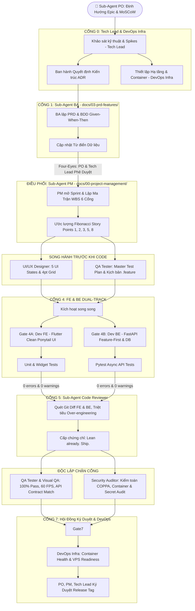

# Quy Trình Phát Triển Tính Năng Toàn Diện (8-Gate Feature Lifecycle SOP) — Kiddora

Tài liệu này chuẩn hóa **Quy trình Phát triển Tính năng Khép kín (End-to-End Feature Delivery SOP)** từ lúc khởi tạo ý tưởng đến khi phát hành ra thị trường, vận hành bởi **11 Sub-Agents Chuyên Trách** theo nguyên tắc kiểm soát chéo (**Four-Eyes Principle**).

---

## 🧭 Sơ Đồ Điều Phối 8 Cổng Chất Lượng (Full-Stack 11 Sub-Agents)

---

## 📋 Chi Tiết Trách Nhiệm Từng Cổng Chất Lượng

### Cổng 0: Nghiên Cứu Kỹ Thuật & Quyết Định Kiến Trúc (Gate 0 — Tech Lead & DevOps Infra)
- **Đầu ra**: Tài liệu `docs/04-specifications/adr/adr-*.md`, file `docker-compose.yml`, biến môi trường `.env.example`.
- **Trách nhiệm**: Đánh giá tính khả thi, phân tích rủi ro bộ nhớ, kiểm soát Cold Start $\le 1.8\text{s}$, chuẩn bị cụm container (FastAPI, DB, Redis, MinIO, LiveKit).

### Cổng 1: Đặc Tả Nghiệp Vụ & BDD Scenarios (Gate 1 — BA & PO)
- **Đầu ra**: Thư mục tính năng `docs/03-prd-features/<feature-name>/prd-*.md` và `user-stories.md`.
- **Trách nhiệm**: BA viết tiêu chuẩn nghiệm thu dạng Given-When-Then chi tiết, PO và Tech Lead đồng ký duyệt Feasibility trước khi code.

### Cổng 2: Thiết Kế Giao Diện Tactile Claymorphism (Gate 2 — UI/UX Designer)
- **Đầu ra**: `docs/03-prd-features/<feature-name>/ui-ux-screen-specs.md`.
- **Trách nhiệm**: Bố cục lưới 4pt, 5 trạng thái màn hình (`default`, `hover`, `active/pressed`, `disabled`, `error`), tương thích chuẩn WCAG 2.2 AA.

### Cổng 3: Thiết Kế Kế Hoạch Kiểm Thử Sớm (Gate 3 — QA Tester)
- **Đầu ra**: `docs/03-prd-features/<feature-name>/gate-3-test.md` và file kịch bản `.feature`.
- **Trách nhiệm**: Bao phủ 100% kịch bản kiểm thử Happy Path và Edge Cases (mất mạng, xoay màn hình, nhập sai, lỗi API 401/404/500).

### Cổng 4: Triển Khai Mã Nguồn Song Hành (Gate 4A Dev FE & Gate 4B Dev BE)
- **Cổng 4A (Dev FE — Flutter)**:
  - Mã nguồn trong `lib/features/<feature-name>/` và `test/`.
  - Feature-First Clean Architecture, Riverpod Notifier, AutoRoute. 100% `AppValues`, không emojis trong code, 100% `AppStrings`.
- **Cổng 4B (Dev BE — FastAPI & Database)**:
  - Mã nguồn trong `backend/app/modules/<feature-name>/` và `backend/tests/`.
  - Feature-First Modular Monolith, SQLAlchemy 2.0 Async, Pydantic DTOs, Alembic migrations, Redis caching, Celery background worker, Pytest.

### Cổng 5: Rà Soát Tinh Gọn Ponytail (Gate 5 — Code Reviewer)
- **Đầu ra**: Biên bản rà soát `gate-5-ponytail-review.md`.
- **Trách nhiệm**: Săn tìm và triệt tiêu code thừa, YAGNI, over-engineering trên toàn bộ git diff cả Flutter lẫn Python Backend.

### Cổng 6: Nghiệm Thu Tự Động & Visual QA (Gate 6 — QA Tester & Visual QA)
- **Đầu ra**: Biên bản `gate-6-qa-signoff.md`.
- **Trách nhiệm**: 
  - Chạy `flutter test` đạt $100\%$ pass, kiểm tra tốc độ $60\text{ FPS}$, không RenderFlex overflow khi text scale 1.5x.
  - Chạy `pytest` đạt $100\%$ pass, xác thực tính toàn vẹn hợp đồng API (API Contract Verification).

### Cổng 6.5: Kiểm Toán An Toàn Trẻ Em & Bảo Mật Hạ Tầng (Gate 6.5 — Security Auditor)
- **Đầu ra**: Biên bản `gate-6.5-security-signoff.md`.
- **Trách nhiệm**: Kiểm toán COPPA không lộ PII, cơ chế khóa phụ huynh Parental Gate, rà soát lỗ hổng container Docker, kiểm tra không rò rỉ secret key/JWT secret.

### Cổng 7: Ký Duyệt Phát Hành Tối Cao (Gate 7 — Hội Đồng Phát Hành & DevOps)
- **Đầu ra**: File `release-v*.md`, Git tag chính thức, chứng chỉ sẵn sàng hạ tầng VPS từ `devops-infra`.
- **Trách nhiệm**: Hội đồng PO, PM, Tech Lead, DevOps kiểm tra toàn bộ tiêu chí trước khi đóng gói phát hành.
