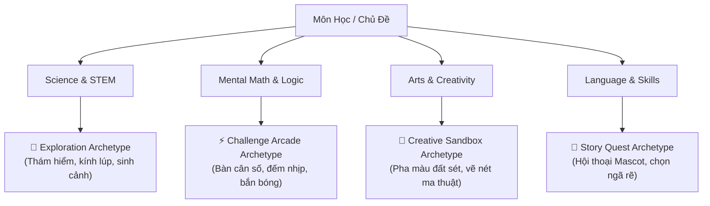

# Đặc Tả Kỹ Thuật: Khung Bài Học Chuẩn 5E Đa Chủ Đề & Hệ Thống Mini-Game Xúc Giác
## Thematic 5E Lesson Template & Tactile Game Design Engine Spec

- **Mã tài liệu**: `SPEC-20261102-LESSON-GAMEDESIGN`
- **Phiên bản**: `1.0.0`
- **Ngày ban hành**: 2026-11-02
- **Tác giả quy trình**: Brainstorming Session giữa User, Sub-Agent Tech Lead & Sub-Agent Game Designer (`game_designer`)
- **Đối tượng áp dụng**: BA, UI/UX Designer, Game Designer, Flutter Core Dev, Backend Dev, QA Tester
- **Ánh xạ kiến trúc**: [pedagogy-learning-rules.md](file:///c:/Projects/kiddora/docs/02-business-rules/pedagogy-learning-rules.md), [prd-course-detail.md](file:///c:/Projects/kiddora/docs/03-prd-features/07-course-detail-and-curriculum/prd-course-detail.md), [ADR-004](file:///c:/Projects/kiddora/docs/04-specifications/adr/adr-004-backend-architecture.md), [epics-backlog.md](file:///c:/Projects/kiddora/docs/00-roadmap/epics-backlog.md) (EPIC-07, EPIC-08, EPIC-10)
- **Trạng thái**: 🟢 **APPROVED (POST-BRAINSTORMING)**

---

## 🎯 1. Bối Cảnh & Mục Tiêu Thiết Kế

### 1.1. Vấn Đề Cần Giải Quyết
Trẻ tiểu học (6–10 tuổi) có mức độ tập trung ngắn và rất dễ chán nếu các bài học bị "đóng khung" theo một khuôn mẫu giao diện đơn điệu (xem video dài rồi chọn A/B/C/D). Đồng thời, mỗi môn học có một đặc thù nhận thức hoàn toàn khác nhau:
- **Khoa học (Science / STEM)** đòi hỏi sự tò mò, khám phá môi trường sống và thực hành thí nghiệm trực quan.
- **Toán tư duy (Mental Math)** đòi hỏi phản xạ tính nhẩm nhanh, nhịp điệu dồn dập và thử thách logic.
- **Nghệ thuật & Sáng tạo (Arts)** đòi hỏi không gian tự do không bị giới hạn bởi điểm số hay câu trả lời đúng/sai tuyệt đối.
- **Ngôn ngữ & Kỹ năng (Language & Life Skills)** đòi hỏi ngữ cảnh hội thoại và tương tác xã hội.

### 1.2. Mục Tiêu Cốt Lõi
1. **Chuẩn Sư Phạm 5E Quốc Tế**: Tích hợp chu trình 5E (*Engage – Explore – Explain – Elaborate – Evaluate*) vào định dạng bài học phân đoạn vi mô (**Bite-sized Learning: 7–12 phút**).
2. **Đa Dạng Hóa Theo Chủ Đề (No Rigid Mold)**: Ứng dụng **4 Kiểu Trải Nghiệm (Thematic Archetypes)** biến hóa linh hoạt theo môn học.
3. **Trải Nghiệm Xúc Giác Độc Bản (Tactile Claymorphism)**: 100% bài tập tương tác được xây dựng dạng mini-game đất sét 3D có độ nảy đàn hồi (Spring physics), rung phản hồi xúc giác (Haptic feedback) và âm thanh vui tai.
4. **Tách Biệt Nội Dung & Mã Nguồn (Content-Engine Decoupling)**: Định nghĩa kịch bản bài học chuẩn **JSON DSL (Domain Specific Language)** cho phép Sub-Agent Game Designer sản xuất hàng trăm bài học mà không cần viết thêm mã nguồn Flutter mới.

---

## 🧩 2. Khung Sư Phạm 5E Đa Chủ Đề & 4 Archetypes Trải Nghiệm

### 2.1. Phân Bổ Thời Lượng Chuẩn 5E Trong Một Bài Học (7–12 Phút)

| Chặng 5E | Tên Chặng | Thời Lượng | Mục Tiêu Nhận Thức | Tương Tác Xúc Giác Cốt Lõi |
| :---: | :--- | :---: | :--- | :--- |
| **E1** | **Engage** *(Khơi gợi)* | $1 – 2\text{ phút}$ | Tạo hook cảm xúc, kích hoạt trí tò mò tự nhiên qua câu đố hoặc tình huống bí ẩn. | Linh vật Mascot 3D nhảy ra đặt câu hỏi thoại, tương tác chạm 1-chạm để bắt đầu. |
| **E2** | **Explore** *(Khám phá)* | $2 – 3\text{ phút}$ | Cho trẻ tự do chạm, mở, thử nghiệm trước khi giảng giải lý thuyết. | Thao tác kéo thả thử nghiệm, soi kính lúp tìm đồ vật ẩn, xoay lật 3D. |
| **E3** | **Explain** *(Giải thích)* | $2 – 3\text{ phút}$ | Đúc kết lý thuyết trọng tâm một cách trực quan, ngắn gọn, dễ nhớ. | Video hoạt hình 3D ngắn (dưới 3 phút) hoặc thẻ tóm tắt minh họa tương tác. |
| **E4** | **Elaborate** *(Vận dụng)* | $3 – 4\text{ phút}$ | **Trọng tâm Mini-Game**: Trẻ áp dụng kiến thức vào thử thách mới vui nhộn có tính thử-sai. | Mini-game xúc giác tương tác cao (phân loại, cân bằng số học, bắn bóng, nối nét). |
| **E5** | **Evaluate** *(Đánh giá)* | $1 – 2\text{ phút}$ | Đo lường mức độ tiếp thu, vinh danh thành tích và giữ lửa học tập. | 1–2 câu hỏi chốt, thưởng $+10\text{ Star Points}$, ngọn lửa Streak bùng cháy, pháo hoa ngôi sao. |

---

### 2.2. Chi Tiết 4 Archetypes Trải Nghiệm Theo Môn Học



1. 🌿 **Exploration Archetype (Dành cho Khoa Học, Sinh Thái, Không Gian)**:
   - *Cảm giác*: Tò mò, phát hiện bí mật thế giới xung quanh.
   - *Hành vi tương tác*: Kính lúp soi vết chân động vật, kéo loài vật vào đúng sinh cảnh (Băng tuyết / Rừng mưa / Biển sâu), ghép các hành tinh trong Hệ Mặt Trời.
2. ⚡ **Challenge Arcade Archetype (Dành cho Toán Tư Duy, Hình Học, Logic)**:
   - *Cảm giác*: Hào hứng, nhịp điệu nhanh, thử thách phản xạ nhẩm tính.
   - *Hành vi tương tác*: Cân thăng bằng số học (Scale Balancer), bấm vỡ bong bóng chứa kết quả đúng, xoay bánh răng logic, combo rung xúc giác liên hoàn khi tính đúng.
3. 🎨 **Creative Sandbox Archetype (Dành cho Mỹ Thuật, Sáng Tạo)**:
   - *Cảm giác*: Tự do, thư giãn, không sợ làm sai.
   - *Hành vi tương tác*: Bảng pha màu đất sét (kéo 2 viên màu hòa vào nhau), nét vẽ phát sáng ma thuật theo đường nét hướng dẫn, dán sticker 3D trang trí phòng học của linh vật.
4. 📖 **Story Quest Archetype (Dành cho Ngôn Ngữ, Kể Chuyện, Kỹ Năng Sống)**:
   - *Cảm giác*: Thân thiện, ấm áp, hóa thân vào câu chuyện.
   - *Hành vi tương tác*: Chạm vào đồ vật để nghe phát âm ngữ âm, chọn nhánh quyết định đúng trong tình huống xã hội (chia sẻ đồ ăn, chào hỏi người lớn).

---

## 🎮 3. Thư Viện Cơ Chế Mini-Game Xúc Giác (Core Tactile Mini-Game Engine)

Hệ thống xây dựng 5 widget gameplay tái sử dụng đặt tại thư mục `lib/shared/ui_kit/games/`:

### 3.1. Danh Mục 5 Widget Mini-Game Chủ Lực

#### 1. `ClayDragDropSorter` (Kéo - Thả Phân Loại Xúc Giác)
- **Mục đích**: Phân nhóm dữ liệu vào 2–3 giỏ/vùng chứa đích.
- **Tương tác**: Chạm giữ vật phẩm co giãn đàn hồi (`scale: 1.06`), khi kéo vào miệng giỏ, giỏ đất sét nhún xuống (`spring bounce`). Thả đúng phát tiếng chuông leng keng + rung nhẹ (`HapticFeedback.lightImpact()`). Thả sai: vật phẩm bay ngược về vị trí cũ kèm tiếng "bloop" (không trừ điểm).

#### 2. `ClayScaleBalancer` (Cân Thăng Bằng Số Học & Trọng Lượng)
- **Mục đích**: Tìm ẩn số toán học hoặc so sánh tương quan lớn hơn / bé hơn.
- **Tương tác**: Cán cân đất sét nghiêng chân thực theo trọng số hai đĩa cân. Khi đạt độ cân bằng chính xác, cán cân phát hào quang vàng Joyful Amber + rung kép xúc giác (`HapticFeedback.mediumImpact()`).

#### 3. `ClayBubblePopper` (Bắn / Bấm Vỡ Bong Bóng Phản Xạ)
- **Mục đích**: Rèn luyện phản xạ đếm số, nhận diện chữ cái, từ vựng hoặc phép tính nhanh.
- **Tương tác**: Các bong bóng đất sét trôi nổi theo dao động sóng sin (`sine wave`). Chạm trúng đáp án đúng, bong bóng nổ tung thành chùm sao nhỏ với âm thanh "pop" giòn tan.

#### 4. `MagicStrokeTracer` (Nét Vẽ Ma Thuật & Nối Điểm Tư Duy)
- **Mục đích**: Luyện vận động tinh (Fine Motor Skills), tô chữ, viết số, nối điểm vẽ hình.
- **Tương tác**: Đường vẽ bám theo ngón tay phát sáng neon trên nền sứ mờ, kéo theo các hạt bụi tiên (fairy dust particles) và âm thanh chuông gió nhẹ nhàng.

#### 5. `ClayCardFlipper` (Lật Thẻ Trí Nhớ & Ghép Đôi Bí Mật)
- **Mục đích**: Rèn luyện trí nhớ ngắn hạn, ghép đôi khái niệm tương đương (Hình ảnh $\leftrightarrow$ Tên gọi; Phép tính $\leftrightarrow$ Kết quả).
- **Tương tác**: Thẻ đất sét lật 3D $180^\circ$ chân thực. Khi ghép đúng 2 thẻ, cả hai thẻ hòa quyện vào nhau và hóa thành 1 ngôi sao vàng bay lên thanh tiến độ.

### 3.2. Ba Quy Tắc Sư Phạm Bất Khả Xâm Phạm (Safe-to-Fail Rules)
1. **Không bao giờ "Game Over"**: Tuyệt đối không có màn hình thua cuộc hay trừ điểm số. Trẻ có vô hạn lượt thử lại.
2. **Hệ thống Gợi ý Thông minh (Smart Hint)**: Sau $15\text{ giây}$ không có tương tác, vật phẩm đúng sẽ khẽ lắc lư (wiggle) và linh vật chỉ ngón tay gợi ý.
3. **Hiệu năng 60 FPS**: Mọi hoạt ảnh kéo thả, nảy và rung phản hồi đạt độ trễ $\le 16\text{ms}$.

---

## 🤖 4. Vai Trò Sub-Agent Game Designer & Kịch Bản JSON DSL

### 4.1. Định Danh Sub-Agent: `game_designer`
- **Tên**: Sub-Agent Game Designer & Gamification Architect (`game_designer`).
- **Nhiệm vụ trong vòng đời 8 Cổng**:
  - **Gate 1 & Gate 2**: Phối hợp cùng BA và UI/UX Designer chuyển hóa mục tiêu bài học thành **Kịch bản Gameplay 5E**.
  - **Thiết kế nhịp độ thử thách (Pacing)**: Màn 1 (Dễ, 1-2 vật thể) $\rightarrow$ Màn 2 (Vừa) $\rightarrow$ Màn 3 (Vận dụng sâu).
  - **Xuất bản kịch bản**: Tạo file JSON DSL hoàn chỉnh cho bài học.

### 4.2. Đặc Tả Schema JSON DSL Của Bài Học (`LessonBlueprint`)

```json
{
  "$schema": "https://kiddora.app/schemas/lesson_blueprint_v1.json",
  "lesson_id": "lesson_anim_01",
  "course_id": "course_amazing_animals",
  "title": "Meet the Animals",
  "archetype": "exploration",
  "target_age_group": "7-10",
  "estimated_duration_mins": 10,
  "stages": [
    {
      "step_order": 1,
      "stage_5e": "engage",
      "type": "mascot_hook",
      "config": {
        "mascot_id": "lion",
        "greeting_text": "Xin chào Keil! Đố bạn biết loài vật nào có bộ lông trắng tinh sống giữa băng tuyết?",
        "audio_url": "assets/audio/prompts/anim_01_hook.mp3",
        "action_cta": "Cùng khám phá nào!"
      }
    },
    {
      "step_order": 2,
      "stage_5e": "explore",
      "type": "peek_reveal",
      "config": {
        "tool": "magnifying_glass",
        "scene_background": "assets/images/scenes/polar_landscape.png",
        "hidden_targets": [
          {"id": "polar_bear", "name": "Gấu Bắc Cực", "hitbox": [120, 240, 80, 80]},
          {"id": "seal", "name": "Hải Cẩu", "hitbox": [280, 310, 60, 60]}
        ]
      }
    },
    {
      "step_order": 3,
      "stage_5e": "explain",
      "type": "bite_sized_video",
      "config": {
        "video_stream_url": "https://storage.kiddora.app/videos/polar_animals_intro.mp4",
        "duration_seconds": 120,
        "key_takeaways": [
          "Gấu Bắc Cực có lớp mỡ dày giữ ấm",
          "Màu lông trắng giúp ngụy trang trong tuyết"
        ]
      }
    },
    {
      "step_order": 4,
      "stage_5e": "elaborate",
      "type": "tactile_mini_game",
      "config": {
        "mechanic": "clay_drag_drop_sorter",
        "instruction": "Hãy đưa các bạn thú về đúng ngôi nhà của mình nhé!",
        "baskets": [
          {"id": "polar", "title": "Băng Tuyết", "theme_color": "sky_blue", "icon": "ice_cube"},
          {"id": "forest", "title": "Rừng Rậm", "theme_color": "meadow_mint", "icon": "tree"}
        ],
        "items": [
          {"id": "polar_bear", "title": "Gấu Bắc Cực", "target_basket": "polar", "asset_url": "assets/images/polar_bear.png"},
          {"id": "monkey", "title": "Khỉ Rừng", "target_basket": "forest", "asset_url": "assets/images/monkey.png"},
          {"id": "penguin", "title": "Chim Cánh Cụt", "target_basket": "polar", "asset_url": "assets/images/penguin.png"}
        ],
        "max_hints": 3
      }
    },
    {
      "step_order": 5,
      "stage_5e": "evaluate",
      "type": "celebration_summary",
      "config": {
        "star_reward": 10,
        "badge_id": "badge_animal_friend",
        "celebration_type": "confetti_and_mascot_cheer",
        "motivational_quote": "Tuyệt vời lắm! Bé đã hoàn thành xuất sắc chuyến thám hiểm!"
      }
    }
  ]
}
```

---

## 🏗️ 5. Kiến Trúc Kỹ Thuật & Tích Hợp Hệ Thống

### 5.1. Cấu Trúc Mã Nguồn Frontend (Flutter Feature-First)
Tọa lạc tại `lib/features/exploration/` và `lib/shared/ui_kit/games/`:

```
lib/
├── features/
│   └── exploration/
│       ├── domain/models/
│       │   ├── lesson_blueprint.dart          # Freezed: Toàn bộ kịch bản bài học
│       │   ├── lesson_stage.dart              # Freezed: Mô hình từng chặng 5E
│       │   └── game_result.dart               # Freezed: Kết quả & tương tác
│       ├── data/
│       │   ├── datasources/lesson_datasource.dart # Đọc file local hoặc fetch API
│       │   └── repositories/lesson_repo_impl.dart
│       └── presentation/
│           ├── controllers/lesson_player_controller.dart # Quản lý stage (1->5), timer
│           ├── pages/lesson_player_screen.dart           # Màn hình mẹ
│           └── widgets/
│               ├── lesson_progress_dots.dart             # Thanh tiến độ hạt đậu nảy
│               ├── lesson_stage_dispatcher.dart          # Bộ điều phối stage
│               └── stage_views/                          # Giao diện 5E con
└── shared/
    └── ui_kit/
        └── games/                                        # 5 Widget mini-game dùng chung
            ├── clay_drag_drop_sorter.dart
            ├── clay_scale_balancer.dart
            ├── clay_bubble_popper.dart
            ├── magic_stroke_tracer.dart
            └── clay_card_flipper.dart
```

### 5.2. Mở Rộng Backend FastAPI & PostgreSQL
1. **Bảng `lessons`**: Bổ sung cột `blueprint_json (JSONB)` lưu kịch bản trò chơi.
2. **API Endpoints**:
   - `GET /api/v1/lessons/{id}/blueprint`: Lấy cấu trúc kịch bản JSON DSL của bài học.
   - `POST /api/v1/lessons/{id}/complete`: Nộp kết quả hoàn thành bài học $\rightarrow$ tự động cộng $+10\text{ Star Points}$ vào hồ sơ bé và cập nhật ngọn lửa Streak.

---

## 🧪 6. Tiêu Chuẩn Nghiệm Thu & Kiểm Thử (Definition of Done)

1. **Kiểm Thử Kịch Bản (Schema Integrity)**: $100\%$ file kịch bản JSON vượt qua bài test cấu trúc dữ liệu, không có ID rác hay tham chiếu sai lệch.
2. **Kiểm Thử Giao Diện & Xúc Giác (Visual & Widget QA)**:
   - Cả 5 widget mini-game hoạt động mượt mà 60 FPS, không có lỗi tràn viền (`RenderFlex overflow`).
   - Phản hồi rung haptic và hiệu ứng nảy đàn hồi hoạt động đúng trên cả iOS và Android.
3. **An Toàn Cho Trẻ (Child-Safe Interaction)**:
   - Không xuất hiện bất kỳ màn hình trừng phạt nào khi trẻ thao tác sai.
   - Nút Thoát (Close/Back) bài học luôn rõ ràng và có hộp thoại xác nhận thân thiện.
4. **Offline Resiliency**: Bài học chơi mượt mà khi ngắt kết nối mạng; tự động lưu và đồng bộ kết quả khi có Internet.

---
*Tài liệu được phê duyệt làm kim chỉ nam thực thi cho Sprint 6 (Lesson Player Engine & Interactive Games).*
