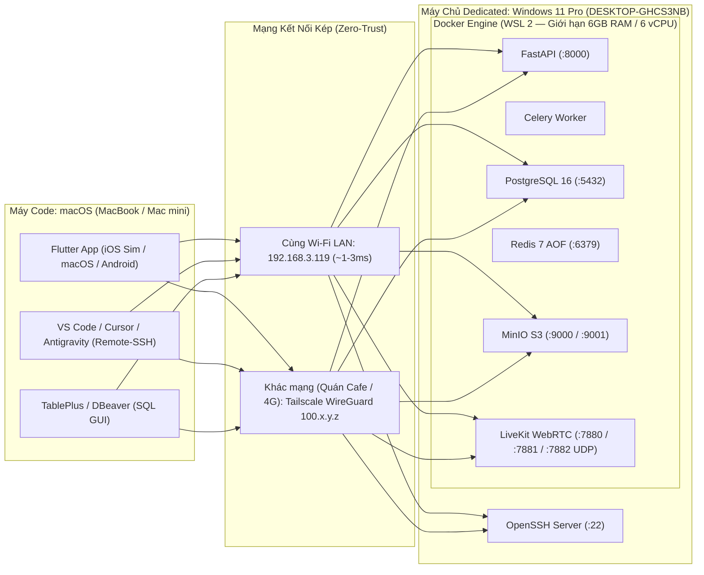

# Hướng Dẫn Vận Hành Hybrid Dev: Máy Chủ Windows 11 Pro & Máy Code macOS

- **Ngày cập nhật**: 2026-10-29
- **Kiến trúc**: Phương Án A — Hybrid Local LAN (`192.168.3.119`) + Tailscale Mesh VPN (`100.x.y.z` / `desktop-ghcs3nb`) + Windows OpenSSH Server
- **Tham chiếu**: [ADR-004](./adr/adr-004-backend-architecture.md) · `CR-008`

---

## 1. Kiến Trúc Kết Nối Tổng Quan



### Cơ Chế Tự Động Hóa Đa Mạng (Zero-Config Switching)
- **MinIO Presigned URLs (`StorageService.resolve_public_endpoint`)**: Khi `MINIO_PUBLIC_ENDPOINT` để trống trong `backend/.env`, FastAPI tự động lấy `request.url.hostname` (ví dụ `192.168.3.119` hoặc IP Tailscale `100.x.y.z`) để ký chữ ký `AWS4-HMAC-SHA256` chuẩn S3v4. Nhờ đó App trên Mac đổi từ Wi-Fi nhà sang Tailscale ngoài quán cafe vẫn upload/stream media trực tiếp vào MinIO mà không bị lỗi `SignatureDoesNotMatch`.
- **LiveKit WebRTC URL (`ClassroomService.resolve_public_url`)**: Tự động trả về `ws://<host>:7880` khớp với địa chỉ máy chủ mà máy Mac đang gọi tới.
- **Redis 7 Persistence**: Chạy với cờ `redis-server --appendonly yes` đảm bảo không mất hàng đợi Celery hay phiên đăng nhập khi khởi động lại máy chủ.

---

## 2. Cấu Hình Đã Thiết Lập Trên Máy Chủ Windows 11 Pro

| Hạng mục | Cấu hình chi tiết | File / Dịch vụ |
| :--- | :--- | :--- |
| **Tên máy & User** | `DESKTOP-GHCS3NB` · User: `Admin` | Windows 11 Pro (Build 26200) |
| **Giới hạn tài nguyên WSL 2** | `memory=6GB`, `processors=6`, `swap=2GB` (giữ ~10GB RAM trống cho Windows) | `C:\Users\Admin\.wslconfig` |
| **Chế độ Nguồn (Power Plan)** | Cắm sạc AC: **Không bao giờ Sleep**, **Không Hibernate**, **Gập màn hình Laptop vẫn chạy 24/7** (`LIDACTION = 0`) | Windows PowerCfg |
| **Tự khởi động cùng Windows** | Docker Desktop tự bật khi đăng nhập | `HKCU\...\Run\Docker Desktop` |
| **Tường lửa Zero-Trust** | Chỉ cho phép dải mạng nội bộ (`LocalSubnet`, `192.168.0.0/16`, `10.0.0.0/8`, `172.16.0.0/12`) và mạng Tailscale (`100.64.0.0/10`) truy cập các cổng `22, 5432, 6379, 7880-7881 TCP, 7882 UDP, 8000, 9000-9001` | `scripts/setup-windows-server-admin.ps1` |
| **SSH Server** | Dịch vụ `sshd` bật `Automatic` trên cổng `22` | Windows OpenSSH Server |

---

## 3. Quy Trình Vận Hành Trên Máy Chủ Windows (1 Lần Sau Khi Khởi Động Lại)

> [!IMPORTANT]
> Vì nhân Linux **WSL 2** vừa được cài mới lần đầu trên Windows, bạn **bắt buộc phải Restart máy Windows 1 lần** để nhân ảo hóa kích hoạt cho Docker Desktop.

### Bước 1: Đăng nhập Tailscale trên Windows
1. Mở ứng dụng **Tailscale** ở khay hệ thống góc phải dưới (System Tray) và đăng nhập (Google / GitHub / Apple).
2. Ghi lại địa chỉ IP Tailscale dạng `100.x.y.z` (hoặc tên MagicDNS `desktop-ghcs3nb`).

### Bước 2: Khởi chạy toàn bộ 6 Services Backend + Database
Mở **PowerShell** tại thư mục `C:\Projects\kiddora` và chạy:

```powershell
powershell -ExecutionPolicy Bypass -File scripts/server-ctl.ps1 up
```

Lệnh `up` sẽ tự động:
1. Build & chạy ngầm 6 containers (`kiddora-api`, `kiddora-worker`, `kiddora-db`, `kiddora-redis`, `kiddora-minio`, `kiddora-livekit`) với chế độ `restart: unless-stopped`.
2. Chạy `alembic upgrade head` để khởi tạo toàn bộ bảng PostgreSQL 16.
3. Khởi tạo bucket `kiddora-storage` trên MinIO kèm quyền đọc media bài giảng/avatar.
4. In bảng tổng hợp toàn bộ URL và câu lệnh `flutter run` dành riêng cho máy Mac.

### Các lệnh quản trị máy chủ thường dùng (`scripts/server-ctl.ps1`)
```powershell
# Xem trạng thái 6 containers + bảng IP LAN & Tailscale
powershell -ExecutionPolicy Bypass -File scripts/server-ctl.ps1 status

# Kéo code Backend mới nhất từ Git, build lại API/Worker & chạy Alembic migration
powershell -ExecutionPolicy Bypass -File scripts/server-ctl.ps1 sync

# Sao lưu Database PostgreSQL ra backups/postgres/ (tự giữ 7 bản gần nhất)
powershell -ExecutionPolicy Bypass -File scripts/server-ctl.ps1 backup

# Xem log trực tiếp của FastAPI và Celery Worker
powershell -ExecutionPolicy Bypass -File scripts/server-ctl.ps1 logs

# Tắt tạm thời containers (dữ liệu DB & MinIO vẫn được giữ nguyên trong Docker Volumes)
powershell -ExecutionPolicy Bypass -File scripts/server-ctl.ps1 down
```

---

## 4. Thiết Lập Trên Máy Code macOS

### Bước 1: Cài đặt Tailscale trên macOS
```bash
brew install --cask tailscale
```
Mở ứng dụng **Tailscale** trên thanh Menu Bar của Mac và đăng nhập **cùng tài khoản** với máy Windows. Bật **MagicDNS** trong trang quản trị Tailscale nếu muốn dùng tên máy `desktop-ghcs3nb` thay cho IP số.

### Bước 2: Clone Source Code & Chạy Flutter Trỏ Về Máy Chủ Windows
Trên máy Mac, bạn **không cần bật Docker hay PostgreSQL** (tiết kiệm 100% RAM/Pin cho iOS Simulator và Xcode):

> [!IMPORTANT]
> **Quy Chuẩn Đồng Bộ SDK & Thư Viện (Zero-Drift Policy)**:
> - Cả 2 máy Windows và macOS **bắt buộc dùng cùng kênh `flutter channel stable` (Flutter 3.29.x / Dart 3.7.x)**.
> - File `pubspec.lock` và `backend/requirements.txt` là Single Source of Truth (SSOT). **Chỉ chạy `flutter pub get`**, tuyệt đối **không chạy `flutter pub upgrade`** làm lệch phiên bản giữa các máy.

```bash
git clone <repo-url> kiddora
cd kiddora
flutter pub get
```

- **Khi ngồi cùng mạng Wi-Fi ở nhà (độ trễ ~1–3ms)**:
  ```bash
  flutter run --dart-define=API_BASE_URL=http://192.168.3.119:8000
  ```
- **Khi mang Mac ra ngoài (quán cafe / 4G qua Tailscale)**:
  ```bash
  flutter run --dart-define=API_BASE_URL=http://100.84.117.43:8000
  # Hoặc nếu bật MagicDNS:
  flutter run --dart-define=API_BASE_URL=http://desktop-ghcs3nb:8000
  ```
- **Trong VS Code / Cursor / Antigravity trên Mac**: Mở tab **Run and Debug** (`Cmd + Shift + D`), chọn sẵn 1 trong 2 cấu hình đã khai báo trong `.vscode/launch.json`:
  - `Kiddora (Remote Windows Server - LAN)`
  - `Kiddora (Remote Windows Server - Tailscale)`

> [!TIP]
> **Lưu ý khi chạy trên iOS Simulator / Thiết bị thật**: Nếu iOS chặn kết nối HTTP nội bộ khi build chế độ đặc biệt, trong giai đoạn Dev trên Simulator iOS cho phép kết nối mạng cục bộ mặc định; khi lên Production (Gate 7) chỉ cần truyền `--dart-define=API_BASE_URL=https://api.kiddora.vn`.

### Bước 3: Kết Nối Quản Trị Database Từ macOS (TablePlus / DBeaver / DataGrip)
Mở phần mềm quản trị DB trên Mac và tạo kết nối **PostgreSQL**:
- **Host**: `192.168.3.119` (cùng Wi-Fi) hoặc `100.84.117.43` (mọi nơi)
- **Port**: `5432`
- **Database**: `kiddora`
- **User**: `kiddora`
- **Password**: `kiddora_secret`
- **SSL Mode**: `Disable` (đã được bảo vệ đầu-cuối bởi WireGuard của Tailscale / mạng nội bộ Private)

### Bước 4: Các Cổng Dịch Vụ Truy Cập Từ Trình Duyệt Safari / Chrome Trên Mac
- **Swagger API Docs (thử nghiệm API trực tiếp)**: `http://192.168.3.119:8000/docs`
- **Health Check**: `http://192.168.3.119:8000/health`
- **MinIO S3 Console (quản lý video/avatar)**: `http://192.168.3.119:9001` (Tài khoản: `minioadmin` / Mật khẩu: `minioadmin123`)

### Bước 5: Điều Khiển & Sửa Code Backend Từ Xa Qua SSH / VS Code Remote-SSH
Từ Terminal trên máy Mac:
```bash
ssh Admin@192.168.3.119
# Hoặc qua Tailscale:
ssh Admin@100.84.117.43
```
Nhập mật khẩu tài khoản Windows `Admin` của bạn. Để không cần nhập mật khẩu những lần sau, chạy trên Mac:
```bash
ssh-keygen -t ed25519 -C "macbook-kiddora"
cat ~/.ssh/id_ed25519.pub | ssh Admin@192.168.3.119 "powershell -Command \"New-Item -Force -ItemType Directory \$env:USERPROFILE\.ssh | Out-Null; Add-Content -Path \$env:USERPROFILE\.ssh\authorized_keys\""
```

Nếu muốn sửa trực tiếp code FastAPI ngay trên máy chủ Windows mà FastAPI `--reload` tự nhận tức thì:
1. Cài extension **Remote - SSH** trên VS Code / Cursor ở máy Mac.
2. Kết nối tới `Admin@192.168.3.119` (hoặc `Admin@100.84.117.43`).
3. Mở thư mục `C:\Projects\kiddora` — mọi thao tác lưu file trong `backend/` sẽ tự động hot-reload bên trong container `kiddora-api`.
