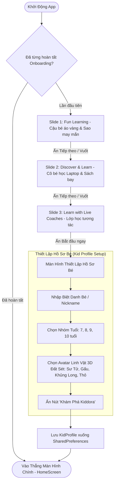

# Gate 1: Product Requirements Document (PRD) & BDD User Stories
## Feature: Sprint 1 — Interactive Onboarding & Kid Profile Identity
**Project**: Kiddora (Kids Learning & Live Classes)  
**Author**: Sub-Agent Business Analyst (BA) — *"The Pedantic Logician"*  
**Reviewer**: Sub-Agent Product Owner (PO) — *"The Strategic Tyrant"* & Tech Lead  
**Date**: 2026-10-19  
**Status**: APPROVED  
**Target Audience**: Trẻ em 7–10 tuổi & Phụ huynh  

---

## 📌 1. Bối Cảnh & Mục Tiêu Định Lượng (Business Context & KPIs)

### 1.1. Bối Cảnh
Kiddora là ứng dụng học tập tương tác cao kết hợp lớp học trực tuyến. Ấn tượng ban đầu trong 30 giây đầu tiên quyết định đến 80% tỷ lệ ở lại của phụ huynh và sự hào hứng của trẻ em. Theo thiết kế tham chiếu [kiddora_full_shot.png](../../assets/design_references/kiddora_full_shot.png), luồng Onboarding phải truyền tải trọn vẹn thông điệp học tập vui vẻ, công nghệ Tactile Claymorphism bắt mắt, và cho phép thiết lập nhanh danh tính của bé (Nickname, Tuổi 7–10, Avatar đất sét) trước khi vào Trang Chủ.

### 1.2. Mục Tiêu Định Lượng (Success Metrics)
1. **Tỷ Lệ Hoàn Thành Onboarding (Funnel Conversion)**: $\ge 92\%$ người dùng tải app hoàn tất cả 3 slide và thiết lập hồ sơ bé.
2. **Thời Gian Hoàn Tất Luồng (Time to First Action)**: Trung bình $\le 40$ giây.
3. **Tỷ Lệ Bỏ Cuộc (Drop-off Rate)**: $< 8\%$ tại bất kỳ bước nào.
4. **Trải Nghiệm Thao Tác (Accessibility & Ergonomics)**: 100% các nút bấm đạt kích thước tối thiểu $48 \times 48\text{dp}$ (khuyến nghị $\ge 56\text{dp}$ cho nút Tiếp tục).

---

## 🔄 2. Luồng Trải Nghiệm Người Dùng (User Journey Flow)



---

## 📋 3. Danh Sách Yêu Cầu Chức Năng (Functional Requirements)

### FR-01: Bộ Điều Hướng Trượt Slide Onboarding (3 Slides)
- **Slide 1**: 
  - Tiêu đề: *"Fun Learning for a Brighter Tomorrow"*
  - Mô tả: *"Khám phá khoá học, tham gia lớp trực tuyến, chơi vui và chinh phục mục tiêu!"*
  - Visual: Nhân vật Bé trai mặc hoodie vàng giơ tay, đeo balo, ôm sách cùng linh vật Ngôi sao vàng vui vẻ và các hạt confetti đất sét.
- **Slide 2**:
  - Tiêu đề: *"Discover & Learn"*
  - Mô tả: *"Chương trình học thú vị thiết kế riêng cho con. Tự do học theo tốc độ cá nhân và phát triển tư duy."*
  - Visual: Cô bé áo hồng ngồi trước laptop ngôi sao đất sét, chồng sách học tập, các icon nổi (Quyển sách, Bảng vẽ, Bình thí nghiệm).
- **Slide 3**:
  - Tiêu đề: *"Learn with Live Coaches"*
  - Mô tả: *"Tham gia lớp trực tiếp, bấm chuông trả lời câu hỏi và học hỏi từ những thầy cô xuất sắc."*
  - Visual: Mô phỏng lớp học trực tuyến, cô giáo thân thiện vẫy tay trên khung màn hình đất sét, bạn nhỏ ngồi học.

### FR-02: Bộ Chỉ Báo Trang & Nút Điều Hướng Xúc Giác (Pagination & CTA)
- Thanh chỉ báo 3 chấm tròn chuyển động mềm mại (`Smooth Page Indicator`) phản chiếu màu tím Indigo `#6366F1`.
- Nút CTA tròn Tactile Clay tròn màu tím chuyển tiếp mũi tên trắng $\rightarrow$ với hiệu ứng Squish vật lý khi nhấn. Tại Slide 3, nút chuyển thành thanh dài: *"Bắt đầu học ngay 🚀"*.

### FR-03: Màn Hình Thiết Lập Hồ Sơ Bé (Kid Profile Setup Screen)
- **Input Tên/Biệt danh**: Ô nhập bo tròn clay, giới hạn 2–16 ký tự, tự động viết hoa chữ cái đầu.
- **Bộ chọn tuổi (Age Selector)**: 4 thẻ tròn đất sét to rõ ràng cho các mốc tuổi `7`, `8`, `9`, `10`. Chỉ được chọn duy nhất 1 tuổi.
- **Bộ chọn Avatar Mascot 3D (Avatar Picker)**: 4 avatar linh vật phong cách đất sét:
  1. 🦁 *Leo Thông Thái* (Mental Math Champion)
  2. 🐻 *Barnaby Khám Phá* (STEM Wonder)
  3. 🦖 *Dino Siêu Trí Tuệ* (Logic Master)
  4. 🐰 *Bunny Nhanh Nhẹn* (Speed Quizzer)
- **Lưu trữ cục bộ**: Ghi nhận `KidProfile` vào `SharedPreferences` kèm cờ `has_completed_onboarding = true`.

---

## 🧪 4. Kịch Bản BDD User Stories Chi Tiết (Given - When - Then)

### US-03: Kịch Bản Trải Nghiệm 3 Slide Onboarding

```gherkin
Feature: Trải Nghiệm Luồng Onboarding 3 Bước

  Scenario: Người dùng mới trượt tuần tự qua 3 slide Onboarding
    Given người dùng vừa cài đặt ứng dụng và mở lần đầu
    And trạng thái 'has_completed_onboarding' trong bộ nhớ máy là false
    When ứng dụng khởi chạy xong
    Then màn hình hiển thị Slide 1 với nhân vật Bé trai áo vàng và Ngôi sao may mắn
    And nút điều hướng hiển thị dạng nút tròn màu tím với mũi tên trắng
    When người dùng bấm vào nút mũi tên hoặc vuốt sang trái
    Then màn hình chuyển mượt mà sang Slide 2 (Discover & Learn) ở tốc độ 60 FPS
    And dấu chấm chỉ báo trang thứ 2 sáng lên
    When người dùng tiếp tục vuốt sang trái
    Then màn hình chuyển sang Slide 3 (Learn with Live Coaches)
    And nút điều hướng mở rộng thành nút dài với nhãn "Bắt đầu học ngay 🚀"

  Scenario: Người dùng vuốt lùi về slide trước đó
    Given người dùng đang ở Slide 2 của Onboarding
    When người dùng vuốt sang phải
    Then ứng dụng quay lại Slide 1
    And thanh chấm trang chuyển điểm sáng về vị trí 1
```

### US-04: Kịch Bản Thiết Lập Hồ Sơ Bé (Kid Profile Setup)

```gherkin
Feature: Thiết Lập Hồ Sơ Bé Ban Đầu

  Scenario: Nhập hợp lệ và hoàn tất tạo hồ sơ bé
    Given người dùng đang ở màn hình Thiết Lập Hồ Sơ Bé
    When người dùng nhập tên "Bé Bo" vào ô Tên
    And người dùng ấn chọn thẻ tuổi "8 tuổi"
    And người dùng ấn chọn linh vật "🦁 Leo Thông Thái"
    Then nút "Khám Phá Kiddora 🚀" chuyển sang trạng thái kích hoạt (Active)
    When người dùng nhấn nút "Khám Phá Kiddora 🚀"
    Then ứng dụng phát âm thanh haptic nhẹ "bloop"
    And dữ liệu hồ sơ được lưu xuống bộ nhớ thiết bị
    And cờ 'has_completed_onboarding' được cập nhật thành true
    And người dùng được điều hướng tới màn hình chính (HomeScreen) với lời chào "Chào Bé Bo! 🚀"

  Scenario: Người dùng chưa nhập tên nhưng cố ấn tiếp tục
    Given người dùng đang ở màn hình Thiết Lập Hồ Sơ Bé
    When ô Tên đang để trống
    Then nút "Khám Phá Kiddora 🚀" ở trạng thái mờ (Disabled)
    And khi nhấn vào không có phản ứng chuyển màn hình
```

---

## 🗄️ 5. Từ Điển Dữ Liệu (Data Dictionary)

### Thực Thể: `KidProfile`
| Tên Trường | Kiểu Dữ Liệu | Bắt Buộc? | Giá Trị Mặc Định | Ràng Buộc Nghiệp Vụ |
| :--- | :---: | :---: | :---: | :--- |
| `id` | `String` | Có | UUID v4 | Mã định danh duy nhất trên máy |
| `nickname` | `String` | Có | - | Từ 2 đến 16 ký tự, không chứa ký tự đặc biệt nguy hiểm |
| `age` | `int` | Có | `8` | Giá trị hợp lệ: $[7, 8, 9, 10]$ |
| `avatarId` | `String` | Có | `'lion'` | Giá trị enum: `lion`, `bear`, `dino`, `bunny` |
| `currentStars` | `int` | Có | `10` | Điểm sao thưởng chào mừng thành viên mới |
| `currentStreak` | `int` | Có | `1` | Chuỗi ngày học bắt đầu từ ngày 1 |
| `createdAt` | `DateTime` | Có | Thời điểm tạo | ISO 8601 UTC String |

### Trạng Thái: `OnboardingState`
| Tên Trường | Kiểu Dữ Liệu | Mô Tả |
| :--- | :---: | :--- |
| `hasCompletedOnboarding` | `bool` | `true` khi đã đi qua cả 3 slide và lưu hồ sơ thành công |
| `currentSlideIndex` | `int` | Chỉ số slide hiện tại ($0, 1, 2$) |

---

## 🛡️ 6. Yêu Cầu Phi Chức Năng (Non-Functional Requirements)

1. **Hiệu Năng Xúc Giác (Tactile Ergonomics)**: Nút bấm phải có phản hồi thị giác trong vòng $< 16\text{ms}$ (1 frame) với hiệu ứng co giãn `scale(0.96)`.
2. **Khả Năng Hoạt Động Ngoại Tuyến (100% Offline Resilience)**: Toàn bộ luồng Onboarding và Profile Setup phải hoạt động trơn tru khi thiết bị bật Airplane Mode (không có kết nối Internet).
3. **Tuân Thủ Quyền Riêng Tư Của Trẻ Em (COPPA Compliance)**: Không thu thập họ tên đầy đủ, số điện thoại, email hay vị trí địa lý của trẻ em tại bước này.

---

## ✅ BIÊN BẢN PHÊ DUYỆT GATE 1 (PRD Sign-Off)
- **Business Analyst**: Sub-Agent BA — *"The Pedantic Logician"* (Đã hoàn thiện tài liệu)
- **Product Owner (PO)**: Sub-Agent PO — *"The Strategic Tyrant"*
- **Tech Lead**: Sub-Agent Tech Lead & System Architect
- **Kết luận thẩm định**: **APPROVED (100% Đạt Tiêu Chuẩn)**
  - *Không có Scope Creep*: Phạm vi khép kín đúng 3 slide và màn hình tạo hồ sơ cơ bản.
  - *Đầy đủ kịch bản BDD*: Happy path & Negative cases rõ ràng.
  - *Chỉ đạo*: Bàn giao ngay sang Sub-Agent **`ui-ux-designer`** (Gate 2) và **`project-manager`** (Sprint Backlog).
