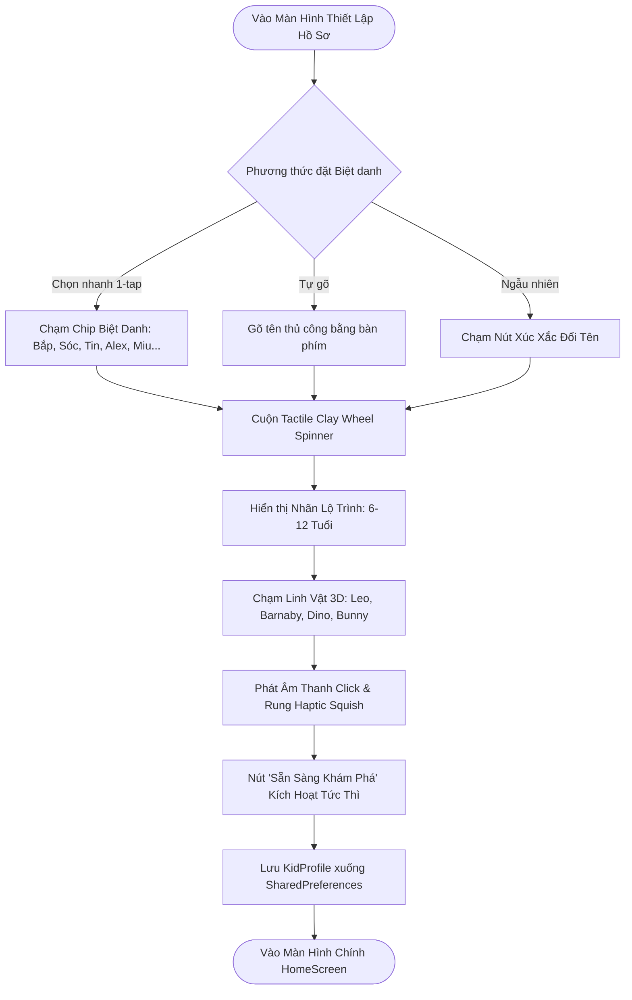

# Gate 1: Product Requirements Document (PRD) & BDD User Stories
## Feature: Sprint 2 — Kid Profile Setup Enhancement (US-04-v2)
**Project**: Kiddora (Kids Learning & Live Classes)  
**Author**: Sub-Agent Business Analyst (BA) — *"The Pedantic Logician"*  
**Reviewer**: Sub-Agent Product Owner (PO) — *"The Strategic Tyrant"* & Tech Lead  
**Status**: **APPROVED**  
**Date**: 2026-10-22  
**Target Audience**: Trẻ em 6–12 tuổi (Trọng tâm: 6–10 tuổi Tiểu học) & Phụ huynh  

---

## 📌 1. Bối Cảnh & Mục Tiêu Định Lượng (Business Context & KPIs)

### 1.1. Bối Cảnh
Sau đợt phát hành Sprint 1, màn hình `KidProfileSetupScreen` đạt tỷ lệ hoàn thành bước đầu nhưng tồn tại 3 điểm nghẽn giảm chuyển đổi: việc gõ bàn phím làm phụ huynh và trẻ nản lòng, 4 nút chọn tuổi cứng nhắc (7, 8, 9, 10) không đón đầu được nhóm trẻ 6 tuổi chuẩn bị vào Lớp 1, và khối ảnh mascot bị bao bởi viền hộp vuông thô ráp. Bản nâng cấp US-04-v2 giải quyết triệt để các rào cản này.

### 1.2. Mục Tiêu Định Lượng (Success Metrics)
1. **Onboarding Completion Rate**: Đạt $\ge 95\%$ (Tăng từ mốc cơ sở $82\%$).
2. **Time to Complete Setup (TTV)**: Giảm xuống $\le 8$ giây nhờ cơ chế chọn Biệt danh 1-tap.
3. **Mức Độ Phủ Tuổi Hợp Lệ**: Hỗ trợ toàn diện trẻ từ **6 tuổi (Lớp 1)** đến **12 tuổi (Đầu cấp 2)**.
4. **Trải Nghiệm Xúc Giác & 60 FPS**: $100\%$ thao tác cuộn bánh xe tuổi và chọn linh vật phản hồi haptic ngay lập tức.

---

## 🔄 2. Luồng Trải Nghiệm Người Dùng (User Journey Flow)



---

## 📋 3. Danh Sách Yêu Cầu Chức Năng (Functional Requirements)

### FR-01: Bộ Gợi Ý Biệt Danh Nhanh (Quick Nickname Chips & Randomizer)
- Ngay dưới ô nhập Tên, hiển thị hàng 4 chip đất sét bo tròn chứa các biệt danh thân thuộc: `Bắp`, `Sóc`, `Tin`, `Alex`.
- Kèm theo 1 nút tròn biểu tượng Xúc xắc (`casino_rounded`) để quay ngẫu nhiên các tên đáng yêu khác (`Miu`, `Sam`, `Ben`, `Đậu`, `Bơ`, `Thỏ`).
- Khi chạm vào bất kỳ chip nào, tên tự động điền vào TextField và cập nhật controller với hiệu ứng Haptic nhẹ.

### FR-02: Bánh Xe Cuộn Tuổi Đất Sét (Tactile Clay Wheel Spinner 6–12 Tuổi)
- Thay thế 4 nút ngang bằng 1 bánh xe cuộn dọc dạng khối trụ đất sét nổi 3D (`ClayAgeWheelSpinner`).
- Dải tuổi hỗ trợ: **Từ 6 tuổi đến 12 tuổi**.
- Giá trị khởi tạo mặc định: **8 tuổi** (ngay vị trí trung tâm).
- Mỗi lần cuộn nấc phát ra 1 nhịp `HapticFeedback.selectionClick()`.
- Phía dưới Spinner hiển thị 1 thẻ nhãn lộ trình học tập tương ứng (Curriculum Hint) theo từng mốc tuổi:
  - `6 tuổi`: *🌱 Chuẩn bị vào Lớp 1: Làm quen chữ số & Đố vui nhận thức*
  - `7 tuổi`: *🚀 Lớp 2: Phép tính vui nhộn & Thám hiểm STEM*
  - `8 tuổi`: *🧩 Lớp 3: Toán tư duy nhân chia & Lớp học trực tuyến*
  - `9 tuổi`: *⚡ Lớp 4: Logic đố vui nâng cao & Bấm chuông tương tác*
  - `10 tuổi`: *🏆 Lớp 5: Thử thách khoa học & Chinh phục đỉnh cao*
  - `11 tuổi`: *🔬 Lớp 6: Toán ứng dụng thực tế & Dự án STEM*
  - `12 tuổi`: *🧠 Lớp 7: Tư duy logic phức hợp & Tinh hoa kiến thức*

### FR-03: Bệ Đỡ Mascot 3D Liền Mạch & Âm Thanh Chào Mừng (Seamless Pedestal & Audio Quip)
- Xóa bỏ hoàn toàn khung chữ nhật màu trắng đè bên trong (`avatar_clay_pedestal.dart`).
- Nhân vật 3D đứng trực tiếp trên bệ đất sét với bóng đổ xúc giác (Ambient Elliptical Shadow).
- Khi chạm vào linh vật: kích hoạt hiệu ứng co giãn xúc giác (Haptic Squish), phát âm thanh hệ thống `SystemSoundType.click`, đổi viền sang tím Indigo `#6366F1` kèm huy hiệu dấu tích tròn.

### FR-04: Nút Hành Động Thông Minh (Smart Responsive CTA)
- Khi tên chưa đủ 2 ký tự: Nút ở trạng thái mờ (Disabled) với màu clay trung tính.
- Khi tên hợp lệ ($\ge 2$ ký tự): Nút lập tức bung sáng màu tím Indigo thương hiệu với hiệu ứng đổ bóng nổi 3D, mời gọi hành động.

---

## 🧪 4. Kịch Bản BDD User Stories (Given - When - Then)

### US-04.1: Gợi ý biệt danh nhanh 1-tap
```gherkin
Feature: Chọn Nhanh Biệt Danh Cho Bé
  Scenario: Phụ huynh chạm vào chip biệt danh có sẵn
    Given người dùng đang ở màn hình Thiết Lập Hồ Sơ Bé
    And ô Tên hiện tại đang để trống
    When người dùng chạm vào chip "Bắp"
    Then ô Tên được tự động điền giá trị "Bắp"
    And nút "Sẵn sàng khám phá!" chuyển sang trạng thái kích hoạt (Active)
    And thiết bị phát một rung động haptic nhẹ

  Scenario: Phụ huynh chạm vào nút xúc xắc ngẫu nhiên
    Given người dùng đang ở màn hình Thiết Lập Hồ Sơ Bé
    When người dùng chạm vào nút Xúc Xắc Đổi Tên
    Then một biệt danh ngẫu nhiên trong danh sách hợp lệ được điền vào ô Tên
    And nút "Sẵn sàng khám phá!" chuyển sang trạng thái kích hoạt (Active)
```

### US-04.2: Cuộn chọn tuổi với bánh xe đất sét Tactile Wheel
```gherkin
Feature: Cuộn Chọn Độ Tuổi Từ 6 Đến 12 Tuổi
  Scenario: Cuộn chọn tuổi 6 tuổi cho bé chuẩn bị vào Lớp 1
    Given người dùng đang ở màn hình Thiết Lập Hồ Sơ Bé
    And bánh xe tuổi đang ở vị trí mặc định 8 tuổi
    When người dùng vuốt bánh xe cuộn về vị trí "6 tuổi"
    Then số "6 tuổi" hiển thị nổi bật ở tâm bánh xe
    And nhãn lộ trình bên dưới hiển thị nội dung "🌱 Chuẩn bị vào Lớp 1: Làm quen chữ số & Đố vui nhận thức"
    And thiết bị phát ra phản hồi haptic selection click
    And giá trị selectedAge trong controller được cập nhật thành 6
```

### US-04.3: Tương tác với linh vật Mascot 3D không viền hộp
```gherkin
Feature: Chọn Linh Vật Mascot Đồng Hành
  Scenario: Chạm chọn linh vật Khủng Long Dino
    Given người dùng đang ở màn hình Thiết Lập Hồ Sơ Bé
    When người dùng chạm vào bệ mascot "Dino"
    Then bệ mascot Dino được viền nổi màu tím Indigo với huy hiệu check
    And hình ảnh Dino hiển thị trực tiếp trên bề mặt bệ clay không có viền vuông hộp phụ
    And âm thanh click xúc giác được phát
    And giá trị selectedAvatarId được cập nhật thành "dino"
```

---

## 🗄️ 5. Từ Điển Dữ Liệu Cập Nhật (Data Dictionary Update)

### Thực Thể: `KidProfile`
| Tên Trường | Kiểu Dữ Liệu | Bắt Buộc? | Giá Trị Mặc Định | Ràng Buộc Nghiệp Vụ Mới |
| :--- | :---: | :---: | :---: | :--- |
| `nickname` | `String` | Có | `''` | Độ dài từ 2 đến 16 ký tự, hỗ trợ điền từ Quick Chip |
| `age` | `int` | Có | `8` | **Ràng buộc mới: $6 \le age \le 12$** (Mở rộng từ $[7, 10]$) |
| `avatarId` | `String` | Có | `'lion'` | Enum: `lion`, `bear`, `dino`, `bunny` |

---

## 🛡️ PHÊ DUYỆT CHÍNH THỨC GATE 1
- **Sub-Agent PO**: APPROVED (Không có scope creep, bám sát Retention).
- **Sub-Agent Tech Lead**: APPROVED (Kiến trúc khả thi, không giật lag).
