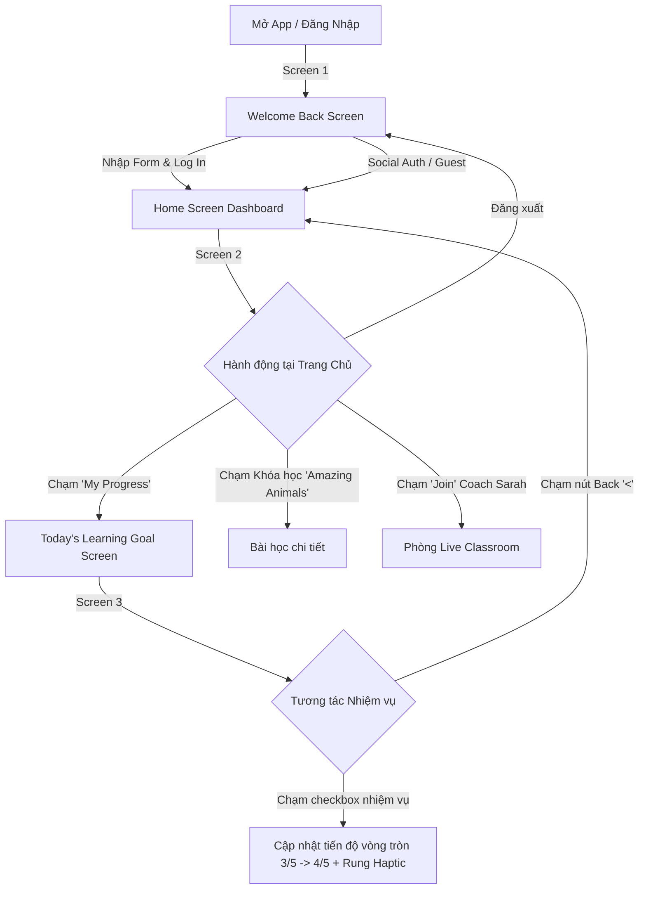

# Gate 1: Product Requirements Document (PRD) & BDD User Stories
## Feature: Sprint 3 — 3 Core Screens 1:1 Implementation (US-05, US-06, US-07)
**Project**: Kiddora (Kids Learning & Live Classes)  
**Author**: Sub-Agent Business Analyst (BA) — *"The Pedantic Logician"*  
**Reviewer**: Sub-Agent Product Owner (PO) — *"The Strategic Tyrant"* & Tech Lead  
**Status**: **APPROVED**  
**Date**: 2026-10-22  
**Target Audience**: Trẻ em 6–10 tuổi Tiểu học & Phụ huynh  
**Design Benchmark**: `assets/design_references/33b01983f3e3be3821bcee2f1b2bdf94.webp`

---

## 📌 1. Bối Cảnh & Mục Tiêu Nghiệp Vụ (Business Objectives & KPIs)

### 1.1. Bối Cảnh
Sau khi người dùng hoàn thành Onboarding hoặc quay lại ứng dụng, Kiddora cần cung cấp một hệ sinh thái trải nghiệm học tập nhất quán, vui tươi, giàu tính xúc giác (Tactile Claymorphism) và kích thích động lực học tập hàng ngày. Dựa trên bản thiết kế đối sánh chuẩn Dribbble (`33b01983f3e3be3821bcee2f1b2bdf94.webp`), Sprint 3 hiện thực hóa 3 màn hình hạt nhân của ứng dụng.

### 1.2. Chỉ Số Đạt Được (Quantitative KPIs)
1. **Login Success Rate**: Đạt $\ge 98\%$ với trải nghiệm form xúc giác trực quan, chống nhầm lẫn.
2. **Daily Goal Engagement (D1/D7 Retention)**: Tăng $35\%$ tỷ lệ trẻ hoàn thành mục tiêu học tập hàng ngày nhờ vòng tròn trực quan hoá nhiệm vụ và linh vật động viên.
3. **Task Completion Interaction**: $100\%$ các lần chạm hoàn thành nhiệm vụ phản hồi Haptic squish tức thì $\le 16\text{ms}$.
4. **Navigation Flow Friction**: Thời gian chuyển đổi giữa Home và Goal Screen $\le 1$ lần chạm (1-Tap access).

---

## 🔄 2. Luồng Trải Nghiệm Người Dùng (User Journey Flow)

---

## 📋 3. Chi Tiết Yêu Cầu Chức Năng Chuẩn BDD (Given-When-Then)

### User Story US-05: Màn Hình Đăng Nhập & Chào Mừng (Welcome Back / Login)
**Là một** phụ huynh hoặc học sinh đã có tài khoản,  
**Tôi muốn** đăng nhập nhanh chóng vào Kiddora với giao diện ấm áp, thân thiện,  
**Để** tiếp tục lộ trình học tập vui vẻ của mình.

#### Scenario 1: Đăng nhập thành công với thông tin hợp lệ
- **Given** người dùng đang ở màn hình `LoginScreen` với logo Kiddora và linh vật bé trai vẫy tay.
- **When** người dùng nhập Email/Username `keil@kiddora.com`, nhập Mật khẩu `Pass123!`, tích chọn `Remember me`, và nhấn nút `Log In`.
- **Then** ứng dụng hiển thị trạng thái nút phản hồi xúc giác, xác thực thông tin và chuyển hướng sang `HomeScreen`.

#### Scenario 2: Chuyển đổi ẩn/hiện mật khẩu
- **Given** người dùng đang nhập mật khẩu tại ô Password.
- **When** người dùng chạm vào biểu tượng con mắt (`Icons.visibility / visibility_off`).
- **Then** mật khẩu chuyển đổi tức thì giữa chế độ ẩn (obscured) và hiển thị ký tự thực.

#### Scenario 3: Lựa chọn đăng nhập qua mạng xã hội
- **Given** người dùng muốn đăng nhập nhanh không cần gõ mật khẩu.
- **When** người dùng chạm vào 1 trong 3 nút tròn xúc giác: Google, Apple, hoặc Microsoft.
- **Then** ứng dụng kích hoạt luồng xác thực tương ứng và đưa người dùng vào Home.

---

### User Story US-06: Trang Chủ Học Tập Sinh Động (Student Home / Dashboard)
**Là một** học sinh tiểu học (như bé Keil),  
**Tôi muốn** nhìn thấy tổng quan lớp học, khóa học đang học dở và buổi học sắp tới tại trang chủ,  
**Để** dễ dàng tiếp tục học mà không cần tìm kiếm phức tạp.

#### Scenario 1: Hiển thị lời chào và thẻ thông tin cá nhân
- **Given** học sinh Keil đăng nhập vào ứng dụng.
- **When** màn hình `HomeScreen` tải xong.
- **Then** hiển thị avatar tròn của bé Keil, lời chào *"Hi, Keil!"*, dòng chữ *"Great to see you again!"*, biểu tượng Chuông thông báo có huy hiệu đỏ số `3`, và nút đăng xuất.

#### Scenario 2: Banner động lực "Keep Learning Keep Growing!"
- **Given** màn hình Home đang hiển thị.
- **When** người dùng quan sát khối Hero Banner trên cùng.
- **Then** hiển thị nền gradient tím mộng mơ với linh vật bé trai đội vương miện vàng, tiêu đề *"Keep Learning Keep Growing!"*, thông điệp *"Small steps make big dreams! ✨"*, và nút tròn mũi tên `->`.

#### Scenario 3: Lưới thao tác nhanh 2x2 (Quick Action Grid)
- **Given** người dùng ở màn hình Home.
- **When** người dùng quan sát lưới 4 thẻ:
  1. Thẻ `My Progress` (icon biểu đồ xanh mint, chú thích *"You're doing great! >"*).
  2. Thẻ `Current Courses` (icon quyển sách xanh dương, chú thích *"3 Active Courses >"*).
  3. Thẻ `Upcoming Session` (icon lịch hồng, chú thích *"Math with Coach Alex >"*).
  4. Thẻ `My Badges` (icon cúp vàng hổ phách, chú thích *"5 Badges Earned >"*).
- **Then** khi chạm vào thẻ `My Progress`, ứng dụng điều hướng ngay sang `TodayLearningGoalScreen`.

#### Scenario 4: Khối "Continue Learning" & "Upcoming Session"
- **Given** người dùng cuộn xem nội dung tiếp theo trên Home.
- **When** người dùng thấy khối *"Continue Learning"*.
- **Then** hiển thị thẻ khóa học Science *"Amazing Animals"* kèm ảnh khủng long xanh 3D, thanh tiến độ tím *"3 of 5 lessons"*, và nút mũi tên tròn tím.
- **And** khối *"Upcoming Session"* hiển thị lớp học *"Math Fun with Numbers"* của giáo viên *"Coach Sarah"*, thời gian *"Today, 4:00 PM"*, và nút bấm xúc giác tím *"Join"*.

---

### User Story US-07: Màn Hình Mục Tiêu Học Tập Hôm Nay (Today's Learning Goal)
**Là một** học sinh tiểu học,  
**Tôi muốn** theo dõi và tick hoàn thành các nhiệm vụ học tập trong ngày,  
**Để** đạt trọn vẹn mục tiêu và cảm thấy tự hào về nỗ lực của bản thân.

#### Scenario 1: Hiển thị Vòng Tròn Tiến Độ Trực Quan & Ngôi Sao Vui Tươi
- **Given** học sinh mở màn hình `TodayLearningGoalScreen`.
- **When** màn hình hiển thị.
- **Then** tiêu đề hiển thị *"Today's Learning Goal"*, phụ đề *"Small steps make big progress!"*.
- **And** ở trung tâm là vòng tròn tiến độ gradient tím bo tròn, ở giữa là ngôi sao đất sét vàng 3D mỉm cười cùng chỉ số *"3 of 5 Tasks Completed"*, bao quanh bởi các tia sáng lấp lánh (sparkles).

#### Scenario 2: Danh sách 5 nhiệm vụ học tập và tương tác Checkbox
- **Given** danh sách 5 nhiệm vụ hôm nay:
  1. [x] *"Watch a lesson"* — Amazing Animals (Đã xong, tích tròn xanh lá).
  2. [x] *"Complete a quiz"* — Animal Facts Quiz (Đã xong, tích tròn xanh lá).
  3. [x] *"Join a live session"* — Math Fun with Numbers (Đã xong, tích tròn xanh lá).
  4. [ ] *"Read a story"* — The Mystery of Space (Chưa xong, vòng tím rỗng).
  5. [ ] *"Earn 10 points"* — Keep going! (Chưa xong, vòng tím rỗng).
- **When** học sinh chạm vào nhiệm vụ số 4 (*"Read a story"*).
- **Then** checkbox chuyển thành tích xanh lá với nhịp rung Haptic tức thì, và số đo vòng tròn tự động nhảy thành *"4 of 5 Tasks Completed"*.

#### Scenario 3: Thẻ Động Viên Ấm Áp Dưới Cùng
- **Given** học sinh cuộn xuống cuối màn hình Goal.
- **When** quan sát thẻ động viên.
- **Then** hiển thị thẻ đất sét màu vàng bơ ấm áp (`#FEF3C7`), hình bé trai 3D giơ ngón tay cái 👍, tiêu đề *"You can do it!"* và lời nhắn *"Keep learning and reach your goal today!"*.

---

## 📊 4. Từ Điển Dữ Liệu (Data Dictionary)

| Trường Dữ Liệu | Kiểu Dữ Liệu | Ràng Buộc & Mặc Định | Mô Tả Nghiệp Vụ |
| :--- | :--- | :--- | :--- |
| `task_id` | `String` | Unique, Non-empty | Mã định danh nhiệm vụ học tập (`task_1` .. `task_5`) |
| `task_title` | `String` | Non-empty, max 40 chars | Tiêu đề hành động (Watch a lesson, Complete a quiz...) |
| `task_subtitle` | `String` | Non-empty, max 50 chars | Tên đối tượng chi tiết (Amazing Animals, Mystery of Space...) |
| `is_completed` | `bool` | Default `false` | Trạng thái hoàn thành của nhiệm vụ |
| `total_tasks` | `int` | $\ge 1$, mặc định $5$ | Tổng số nhiệm vụ mục tiêu trong ngày |
| `completed_count`| `int` | $0 \le n \le total\_tasks$ | Số lượng nhiệm vụ đã hoàn thành |

**Ký duyệt Gate 1**:  
*Sub-Agent BA: The Pedantic Logician — APPROVED*  
*Sub-Agent PO: The Strategic Tyrant — APPROVED*
